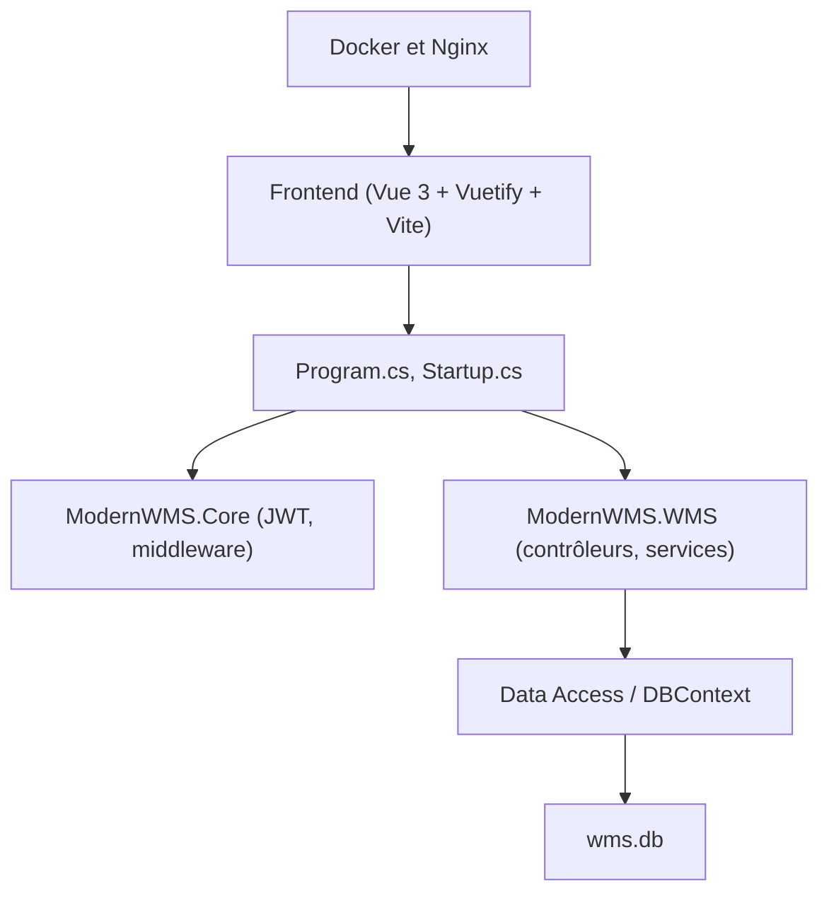

# fjykTec/ModernWMS

> .NET and Vue warehouse management system for small and medium businesses.

## The problem
Small businesses have real warehouse management needs but not the budget for a full ERP.

## What it actually does
A web application: Vue 3 and Vuetify frontend, layered .NET 7 backend (controllers, services, data access), JWT authentication and a demo database `wms.db`. Nginx serves the frontend and the API listens on port 20011. The README describes installation on Linux and Windows, or via Docker.

## How it is wired
Simplified diagram based on the code diagram.



## Trying it
```bash
sudo docker pull modernwms/modernwms:1.0
sudo docker run -d -p 20011:20011 -p 80:80  modernwms/modernwms:1.0 ./run.sh
```

## Cost and gotchas
Free. Manual installation is long (.NET 7 SDK, Node 16, compiled Nginx) and requires changing the IP address in the frontend. The default account is `admin` with password `1`: change it. Last push in June 2025.

## What it is not
It is not a full ERP. It is not a recent project: the .NET and Node versions cited are old.

## Alternatives
No alternative named in the README.

## For you
Ignore for a data / AI / MLOps profile: warehouse management is out of scope, and the repo is barely active.
