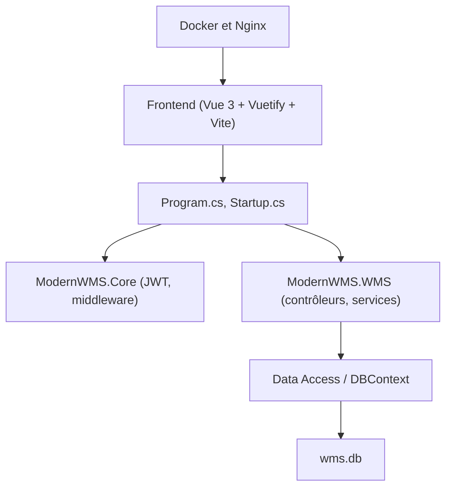

# fjykTec/ModernWMS

> Système de gestion d'entrepôt .NET et Vue pour petites et moyennes entreprises.

## Le problème
Les petites entreprises ont des besoins de gestion d'entrepôt réels mais pas le budget d'un ERP complet.

## Ce que ça fait vraiment
Une application web : frontend Vue 3 et Vuetify, backend .NET 7 en couches (contrôleurs, services, accès aux données), authentification JWT et base de démonstration `wms.db`. Nginx sert le frontend et l'API écoute sur le port 20011. Le README décrit l'installation sur Linux et Windows, ou via Docker.

## Comment c'est branché
Schéma simplifié d'après le diagramme du code.



## Essayer
```bash
sudo docker pull modernwms/modernwms:1.0
sudo docker run -d -p 20011:20011 -p 80:80  modernwms/modernwms:1.0 ./run.sh
```

## Coût et pièges
Gratuit. L'installation manuelle est longue (SDK .NET 7, Node 16, Nginx compilé) et demande de modifier l'adresse IP dans le frontend. Le compte par défaut est `admin` avec le mot de passe `1` : à changer. Dernier push en juin 2025.

## Ce que ce n'est pas
Ce n'est pas un ERP complet. Ce n'est pas un projet récent : les versions de .NET et de Node citées sont anciennes.

## Alternatives
Aucune alternative nommée dans le README.

## Pour toi
À ignorer pour un profil data / IA / MLOps : une gestion d'entrepôt hors périmètre, avec un dépôt peu actif.

