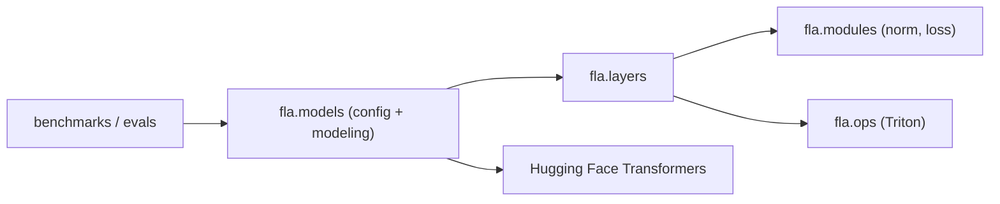

# fla-org/flash-linear-attention

> Triton building blocks for linear attention, state-space models and hybrids, for sequence-model researchers.

## The problem
Papers on linear attention and SSMs each have their own repository, kernels and conventions.

## What it actually does
A collection of layers (`fla.layers`), Hugging Face Transformers-compatible models (`fla.models`), fused modules (normalizations, cross-entropy, KL) and Triton kernels (`fla.ops`). A table of more than 35 architectures (RetNet, GLA, DeltaNet, Mamba2, RWKV7, NSA, etc.). Hybrid models through the `attn` field, the `flame` training framework on torchtitan, evaluation with lm-evaluation-harness. Verified on NVIDIA, AMD and Intel.

## How it is wired


## Trying it
```bash
pip install flash-linear-attention[cuda]
pip install --index-url https://download.pytorch.org/whl/rocm7.2 torch
pip install flash-linear-attention[rocm]
python -m benchmarks.benchmark_generation --path 'fla-hub/gla-1.3B-100B' --repetition_penalty 2. --prompt="Hello everyone, I'm Songlin Yang"
python -m benchmarks.ops.run --op chunk_retention chunk_gla chunk_gdn flash_attn
```

## Cost and gotchas
Free, but a GPU is required; the bare install no longer pulls in torch or triton (choose a `cuda`, `rocm`, `xpu`, `npu` or `cpu` extra). The cross-entropy fused with the linear layer is disabled by default (lower precision).

## What it is not
Not a catalog of pretrained models ready for production. The README's measurements show that FlashAttention2 remains faster on small shapes (e.g. B=8, T=1024): the gain depends on sequence length.

## Alternatives
Liger-Kernel: cited for the fused linear cross-entropy.

## For you
Adopt if you experiment with or train sequence architectures on GPU; otherwise irrelevant.
