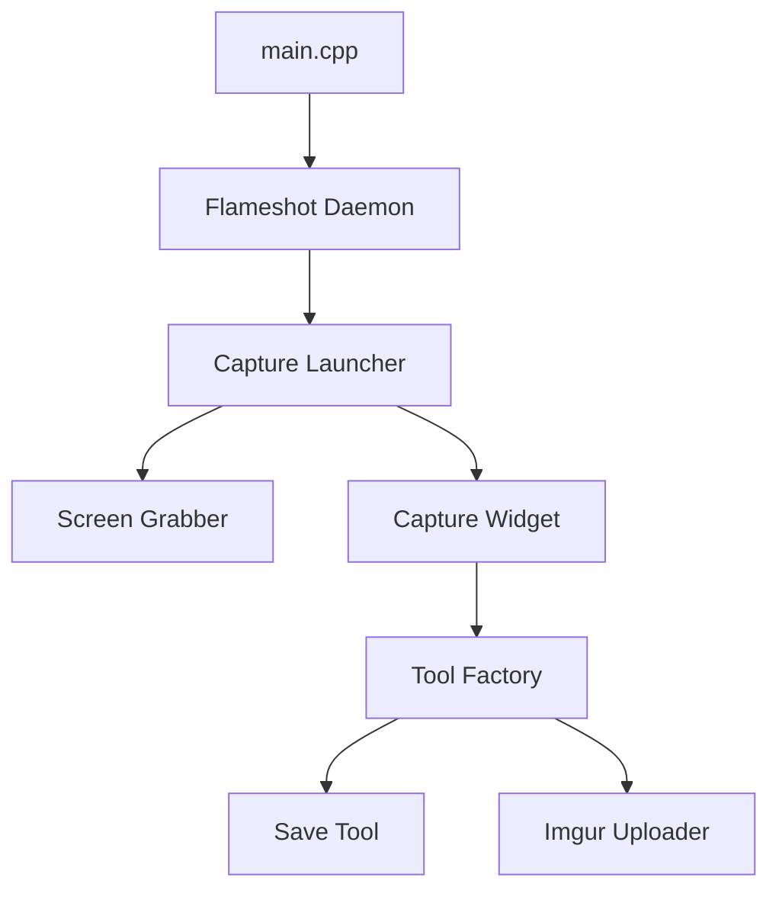

# flameshot-org/flameshot

> Screenshot software with a built-in editor, for Linux, Windows and macOS.

## The problem
Annotating a screenshot usually requires a second tool after the capture.

## What it actually does
A background daemon starts a capture via CLI, global shortcut, system tray icon or DBus. An editing layer offers pen, arrow, rectangle, text, pixelation, color picker. The result can be saved, copied or sent to Imgur. Configuration goes through a window or `~/.config/flameshot/flameshot.ini`.

## How it is wired



## Trying it
```bash
flameshot gui
flameshot gui -d 2000
flameshot full -c -p ~/myStuff/captures
flameshot config
```

## Cost and gotchas
Free. On Gnome Wayland or Plasma Wayland, support is described as experimental. On Gnome, an extension is needed to see the system tray icon. Building requires Qt 6.2.4+, GCC 11+ and CMake 3.22+.

## What it is not
It is not a video recorder. Sending to Imgur is an action you trigger, nothing is sent automatically according to the README's privacy policy. There is no uninstaller for an install from source.

## Alternatives
- Spectacle: KDE's capture tool, whose shortcuts may conflict.
- xfce4-screenshooter: XFCE's tool, replaceable with `flameshot gui`.

## For you
Adopt: useful to illustrate reports and tickets of a data project in seconds; no impact on your pipelines.
