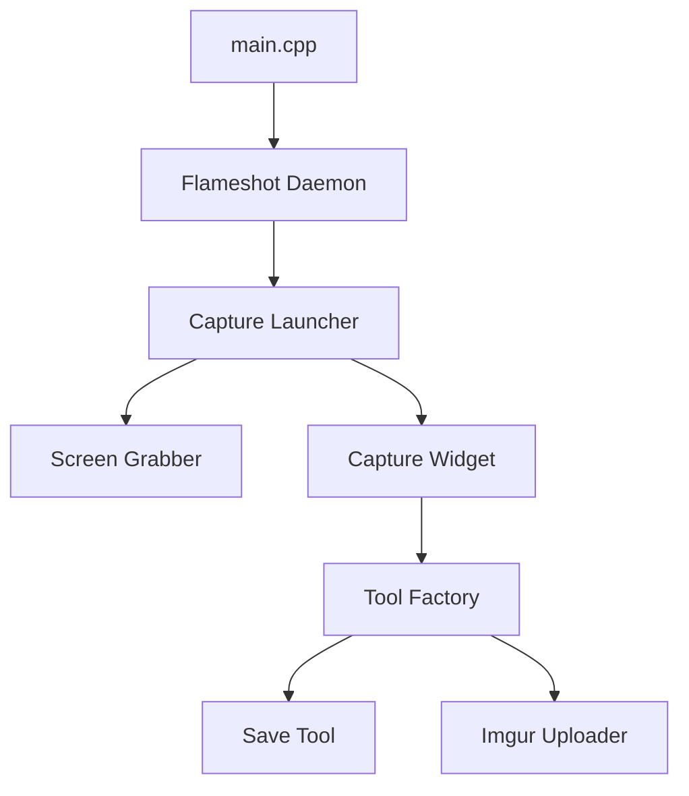

# flameshot-org/flameshot

> Logiciel de capture d'écran avec éditeur intégré, pour Linux, Windows et macOS.

## Le problème
Annoter une capture d'écran demande d'ordinaire un second outil après la capture.

## Ce que ça fait vraiment
Un démon en arrière-plan lance une capture par CLI, raccourci global, icône de zone de notification ou DBus. Un calque d'édition propose crayon, flèche, rectangle, texte, pixellisation, pipette. Le résultat peut être enregistré, copié ou envoyé sur Imgur. La configuration passe par une fenêtre ou `~/.config/flameshot/flameshot.ini`.

## Comment c'est branché



## Essayer
```bash
flameshot gui
flameshot gui -d 2000
flameshot full -c -p ~/myStuff/captures
flameshot config
```

## Coût et pièges
Gratuit. Sous Gnome Wayland ou Plasma Wayland, le support est dit expérimental. Sous Gnome, il faut une extension pour voir l'icône de la zone de notification. La compilation demande Qt 6.2.4+, GCC 11+ et CMake 3.22+.

## Ce que ce n'est pas
Ce n'est pas un enregistreur vidéo. L'envoi vers Imgur est une action à déclencher, rien ne part tout seul d'après la politique de confidentialité du README. Il n'y a pas de désinstalleur pour une installation depuis les sources.

## Alternatives
- Spectacle : l'outil de capture de KDE, dont les raccourcis peuvent entrer en conflit.
- xfce4-screenshooter : l'outil de XFCE, remplaçable par `flameshot gui`.

## Pour toi
À adopter : utile pour illustrer rapports et tickets d'un projet data en quelques secondes ; sans impact sur tes pipelines.

