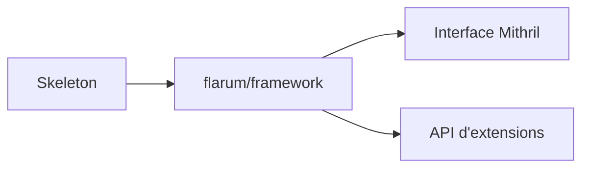

# flarum/framework

> The core code of Flarum, a PHP discussion platform, for anyone setting up a forum.

## The problem
Hosting an online community requires a forum that is simple to deploy, without heaviness.

## What it actually does
This repository contains the core of Flarum: a PHP forum with a Mithril interface and an extensions API. The README details neither the features nor the architecture. To set up a forum, it points to the skeleton repository.

## How it is wired
Simplified diagram based on the fiche, no diagram provided.

## Trying it
No command is documented in the README: it points to the documentation and the skeleton repository.

## Cost and gotchas
Free. PHP hosting is needed, not detailed here. This repository alone is not enough to install a forum.

## What it is not
Not a forum installable from this repository. Not a data tool.

## Alternatives
No alternative named in the README.

## For you
Ignore: a PHP forum has no connection with data, AI or MLOps work.
