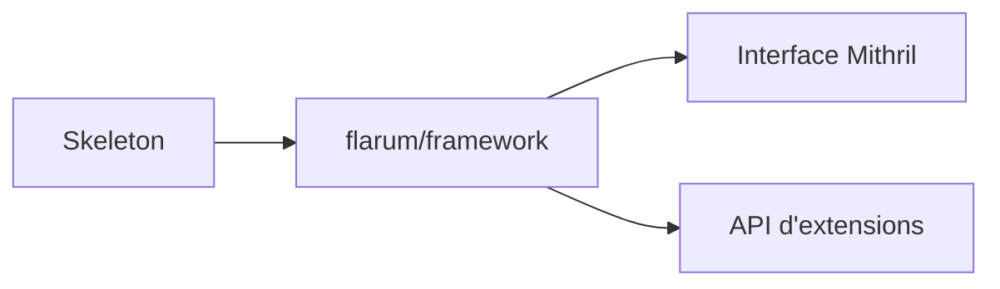

# flarum/framework

> Le code cœur de Flarum, une plateforme de discussion en PHP, pour qui monte un forum.

## Le problème
Héberger une communauté en ligne demande un forum simple à déployer, sans lourdeur.

## Ce que ça fait vraiment
Ce dépôt contient le cœur de Flarum : un forum en PHP avec interface Mithril et une API d'extensions. Le README ne détaille ni les fonctions ni l'architecture. Pour monter un forum, il renvoie au dépôt skeleton.

## Comment c'est branché
Schéma simplifié d'après la fiche, sans diagramme fourni.

## Essayer
Aucune commande n'est documentée dans le README : il renvoie à la documentation et au dépôt skeleton.

## Coût et pièges
Gratuit. Il faut un hébergement PHP, non détaillé ici. Ce dépôt seul ne suffit pas pour installer un forum.

## Ce que ce n'est pas
Pas un forum installable depuis ce dépôt. Pas un outil data.

## Alternatives
Aucune alternative nommée dans le README.

## Pour toi
À ignorer : un forum PHP n'a aucun lien avec un travail data, IA ou MLOps.

