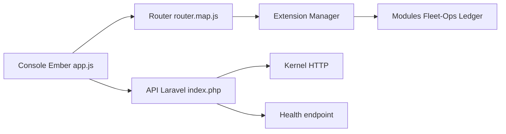

# fleetbase/fleetbase

> Modular logistics operating system (dispatch, fleet, warehouse, billing), self-hosted or in the cloud.

## The problem
Carriers and delivery companies depend on proprietary TMSs that are hard to adapt.

## What it actually does
An Ember.js console and a Laravel API. Features are installed as extensions: Fleet-Ops (orders, drivers, tracking), Storefront, Pallet (warehouse), Ledger (billing), Customer Portal, IAM, Developers (API keys, webhooks) and an AI module that creates orders in natural language through OpenAI or Claude. Two mobile apps, for drivers and for shops, are open source. The code of the operational modules is not in this repo.

## How it is wired


## Trying it
```bash
npm install -g @fleetbase/cli
flb install-fleetbase
# console: http://localhost:4200 ; API: http://localhost:8000
```

## Cost and gotchas
Docker Compose v2, Git, Node 18+, 4 GB of RAM allocated to Docker. Mail, maps and SMS are configured afterwards. A Fleetbase Cloud offer exists (free trial).

## What it is not
Not an AI or data tool: it is a business application. The AGPL-3.0 license requires you to publish modifications if you offer it as a network service.

## Alternatives
No alternative is cited in the README.

## For you
Ignore for a data/AI/MLOps profile: off topic, AGPL, unless you have a specific logistics project (the AI module is only an add-on).
