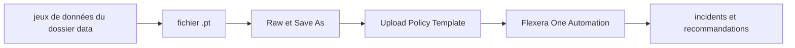

# flexera-public/policy_templates

> Library of Flexera policy templates to optimize, audit and secure cloud costs and resources.

## The problem
Monitoring costs, compliance and security on AWS, Azure and Google requires reusable rules inside the Flexera One platform.

## What it actually does
Provides `.pt` files sorted into categories: optimization, compliance, cost, operations, SaaS management and security. Each template is downloaded then loaded into the Automation section of Flexera One. The repository also offers datasets (regions, prices, instance types) and the `fpt` tool.

## How it is wired
Simplified diagram based on the sheet, no diagram provided.

## Trying it
The README documents no shell command: loading is done through the interface ("Upload Policy Template" button in Flexera One).

## Cost and gotchas
You need a Flexera One account with policy management roles and cloud credentials with the right permissions. The platform's cost is not stated in the README.

## What it is not
Not a standalone tool: these templates only run in Flexera One. It is not an open FinOps engine.

## Alternatives
No alternative named in the README.

## For you
Ignore: useful only if your organization already has Flexera One, which is not the case for a typical data or MLOps profile.
