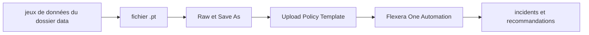

# flexera-public/policy_templates

> Bibliothèque de modèles de politiques Flexera pour optimiser, auditer et sécuriser des coûts et ressources cloud.

## Le problème
Surveiller coûts, conformité et sécurité sur AWS, Azure et Google demande des règles réutilisables dans la plateforme Flexera One.

## Ce que ça fait vraiment
Fournit des fichiers `.pt` classés en catégories : optimisation, conformité, coûts, opérations, gestion SaaS et sécurité. Chaque modèle est téléchargé puis chargé dans la section Automation de Flexera One. Le dépôt offre aussi des jeux de données (régions, prix, types d'instances) et l'outil `fpt`.

## Comment c'est branché
Schéma simplifié d'après la fiche, sans diagramme fourni.

## Essayer
Le README ne documente aucune commande shell : le chargement se fait par l'interface (bouton « Upload Policy Template » dans Flexera One).

## Coût et pièges
Il faut un compte Flexera One avec les rôles de gestion des politiques et des identifiants cloud aux bonnes permissions. Le coût de la plateforme n'est pas indiqué dans le README.

## Ce que ce n'est pas
Pas un outil autonome : ces modèles ne tournent que dans Flexera One. Ce n'est pas un moteur de FinOps libre.

## Alternatives
Aucune alternative nommée dans le README.

## Pour toi
À ignorer : utile seulement si ton organisation a déjà Flexera One, ce qui n'est pas le cas d'un profil data ou MLOps typique.

