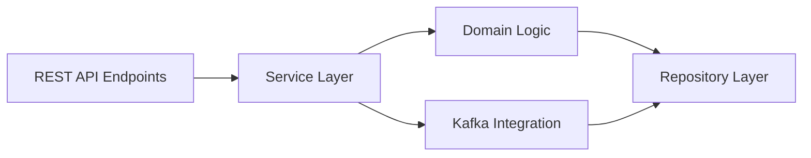

# flexprice/flexprice

> Self-hostable usage-based and credit-based billing infrastructure, for SaaS and AI teams.

## The problem
Classic billing tools handle event counting, prepaid credits and hybrid pricing poorly; teams hack together their own logic.

## What it actually does
Receives usage events through API/SDK, aggregates them in real time, applies plans, credits, feature limits, then generates invoices. Plugs into Stripe, Chargebee, CRM and accounting. The code architecture describes PostgreSQL, ClickHouse, Kafka, Temporal and a layered architecture (API, services, domain, repositories).

## How it is wired


## Trying it
```bash
git clone https://github.com/flexprice/flexprice
cd flexprice
make dev-setup
```

## Cost and gotchas
Heavy stack to host: PostgreSQL, Kafka, ClickHouse, Redis, Temporal. Go and Docker Compose prerequisites. AGPL-3.0 license.

## What it is not
Not a simple payment module: it complements an existing payment processor. The README gives no production deployment procedure, only the development environment.

## Alternatives
- Stripe / Chargebee: the README cites them as processors to complement, not replace.

## For you
Worth watching: relevant if you bill an API or AI tokens, but AGPL and a Kafka/ClickHouse stack to operate weigh heavily for isolated use.
