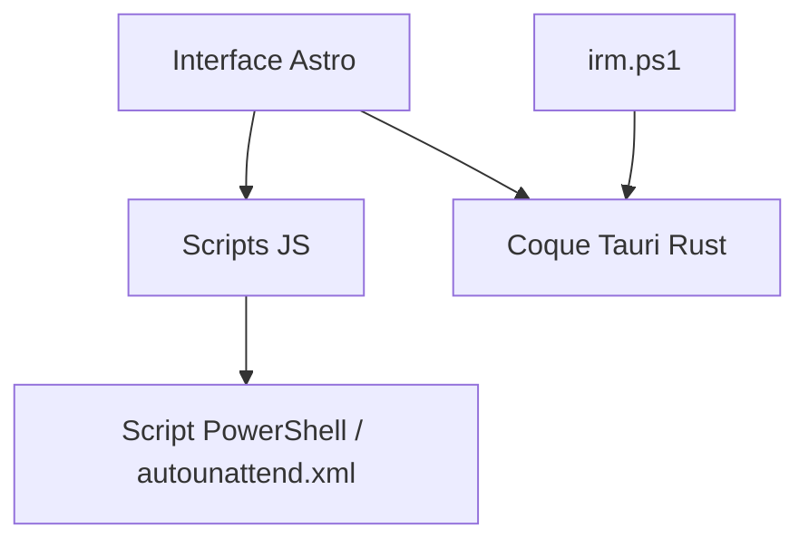

# flick9000/winscript

> Windows tool that generates scripts to debloat the system, reduce telemetry and install applications in bulk.

## The problem
A fresh Windows ships with superfluous components and telemetry, to be cleaned up by hand.

## What it actually does
Desktop application (Astro + Tauri/Rust shell) that produces PowerShell scripts: removal of components (Edge, OneDrive, Copilot...), privacy settings, performance tweaks, application installation via Chocolatey or Winget, and an `autounattend.xml` file for unattended installation. No central backend; JSON configuration import.

## How it is wired


## Trying it
```bash
irm "https://winscript.cc/irm" | iex
winget install winscript
.\winscript.exe -i "C:\path\to\config.json"
```

## Cost and gotchas
Free. Running remote code via `irm | iex` requires trust; the tweaks modify the system deeply (Defender, services).

## What it is not
Not an enterprise administration tool: it is a personal workstation customization utility.

## Alternatives
No alternative named in the README.

## For you
Ignore: a Windows workstation utility, unrelated to data/AI/MLOps work.
