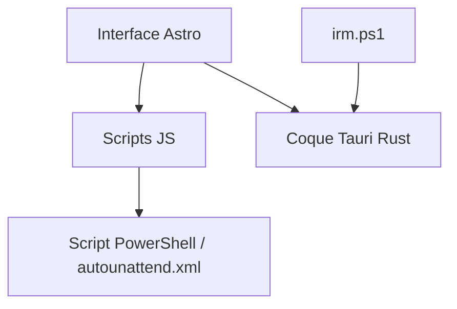

# flick9000/winscript

> Outil Windows qui génère des scripts pour dégraisser le système, réduire la télémétrie et installer des applications en lot.

## Le problème
Un Windows neuf embarque des composants superflus et de la télémétrie, à nettoyer à la main.

## Ce que ça fait vraiment
Application de bureau (Astro + coquille Tauri/Rust) qui produit des scripts PowerShell : suppression de composants (Edge, OneDrive, Copilot…), réglages de confidentialité, ajustements de performance, installation d'applications via Chocolatey ou Winget, et fichier `autounattend.xml` d'installation automatisée. Aucun backend central ; import de configuration JSON.

## Comment c'est branché


## Essayer
```bash
irm "https://winscript.cc/irm" | iex
winget install winscript
.\winscript.exe -i "C:\path\to\config.json"
```

## Coût et pièges
Gratuit. Exécuter du code distant via `irm | iex` demande confiance ; les tweaks modifient le système en profondeur (Defender, services).

## Ce que ce n'est pas
Pas un outil d'administration d'entreprise : c'est un utilitaire de personnalisation poste individuel.

## Alternatives
Aucune alternative nommée dans le README.

## Pour toi
À ignorer : utilitaire de poste Windows, sans lien avec le travail data/IA/MLOps.

