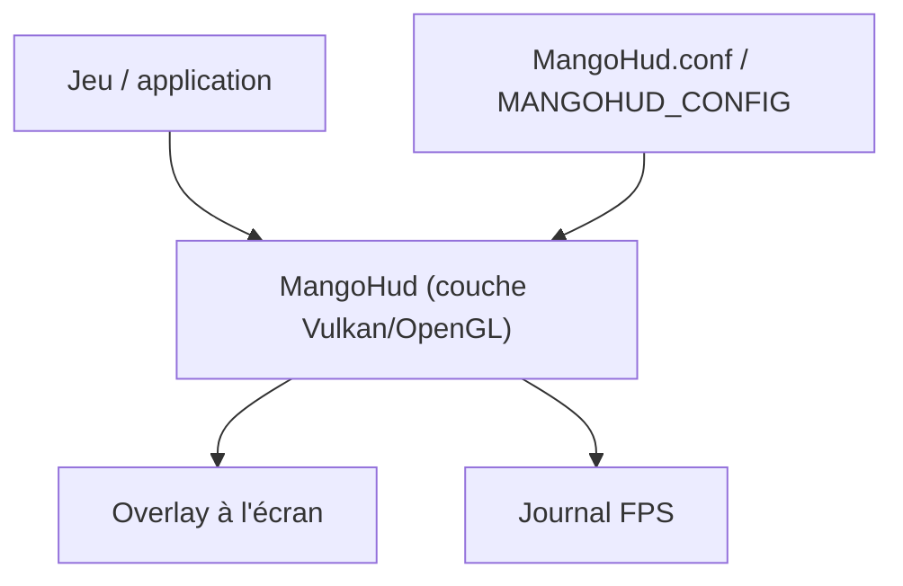

# flightlessmango/MangoHud

> Vulkan and OpenGL overlay that displays FPS, temperatures and CPU/GPU load, for Linux gamers.

## The problem
Measuring a game's performance on Linux requires separate tools.

## What it actually does
A Vulkan/OpenGL layer injected into the application that displays FPS, frametime, CPU/GPU load and temperatures, battery, memory, with FPS logging, per-application config and hotkeys. Compatible with Steam, Lutris, gamescope (via mangoapp) and Flatpak. More than 50 configuration parameters.

## How it is wired

Diagram inferred from the README, no diagram provided.

## Trying it
```bash
git clone --recurse-submodules https://github.com/flightlessmango/MangoHud.git
cd MangoHud
./build.sh build
./build.sh install
mangohud /path/to/app
```

## Cost and gotchas
Free. Many build dependencies (meson, ninja, Vulkan, etc.). Gamescope requires mangoapp.

## What it is not
Not a GPU benchmarking tool for training: it targets gaming. The README provided is truncated; the detail of some parameters was not read.

## Alternatives
No alternative named in the README.

## For you
Ignore: useful for gaming on Linux, unrelated to GPU load monitoring in MLOps.
