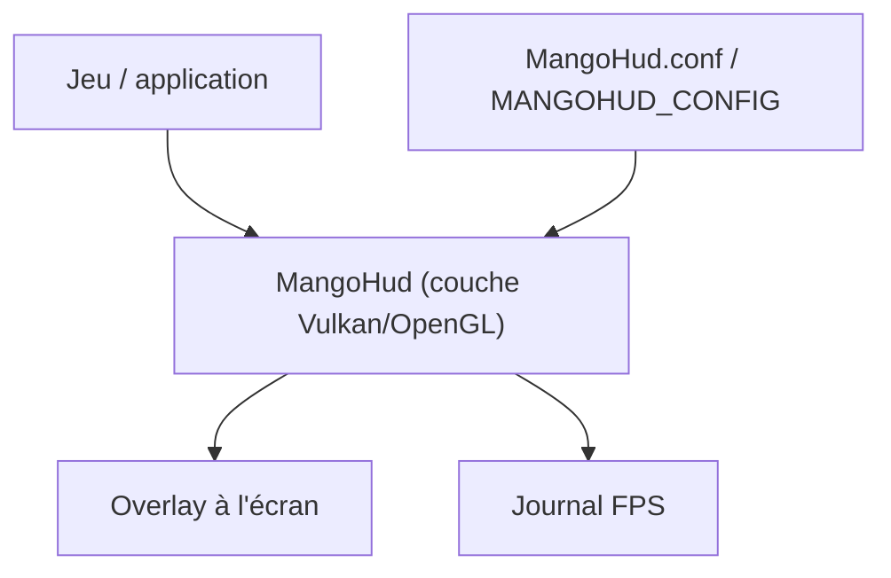

# flightlessmango/MangoHud

> Surcouche Vulkan et OpenGL qui affiche FPS, températures et charge CPU/GPU, pour joueurs Linux.

## Le problème
Mesurer les performances d'un jeu sous Linux demande des outils séparés.

## Ce que ça fait vraiment
Une couche Vulkan/OpenGL injectée dans l'application qui affiche FPS, frametime, charge et températures CPU/GPU, batterie, mémoire, avec journalisation FPS, config par application et raccourcis. Compatible Steam, Lutris, gamescope (via mangoapp) et Flatpak. Plus de 50 paramètres de configuration.

## Comment c'est branché

Schéma déduit du README, sans diagramme fourni.

## Essayer
```bash
git clone --recurse-submodules https://github.com/flightlessmango/MangoHud.git
cd MangoHud
./build.sh build
./build.sh install
mangohud /path/to/app
```

## Coût et pièges
Gratuit. Dépendances de compilation nombreuses (meson, ninja, Vulkan, etc.). Gamescope exige mangoapp.

## Ce que ce n'est pas
Pas un outil de benchmark de GPU pour l'entraînement : il cible le jeu. Le README fourni est tronqué, le détail de certains paramètres n'a pas été lu.

## Alternatives
Aucune alternative nommée dans le README.

## Pour toi
Ignorer : utile pour jouer sous Linux, sans rapport avec le suivi de charge GPU en MLOps.

