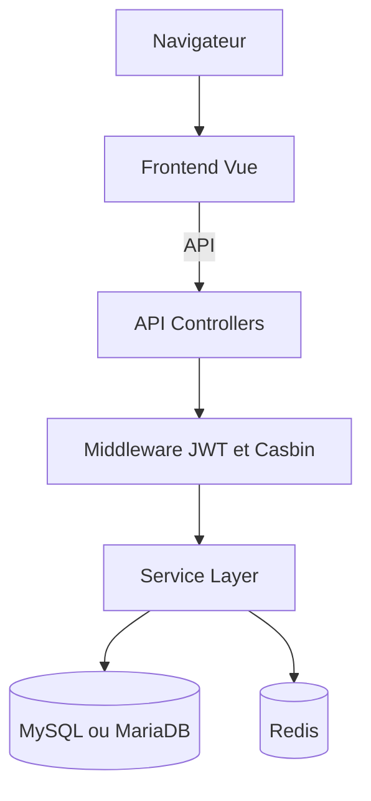

# flipped-aurora/gin-vue-admin

> Socle d'application d'administration en Go (Gin) et Vue, avec droits, menus dynamiques et générateur de code.

## Le problème
Démarrer une application d'administration (utilisateurs, rôles, menus, API) oblige à réécrire à chaque projet la même base.

## Ce que ça fait vraiment
Une plateforme de développement séparant frontend Vue (Element) et backend Gin : authentification JWT, droits Casbin, menus et rôles dynamiques, gestion d'API, envoi de fichiers vers des clouds chinois (Qiniu, Aliyun, Tencent), limitation de connexions multiples via Redis, générateur de code CRUD, générateur de formulaires et documentation Swagger. Base MySQL ou MariaDB, journaux avec zap.

## Comment c'est branché


## Essayer
```bash
git clone https://github.com/flipped-aurora/gin-vue-admin.git
cd server
go generate
go run .
cd web
npm install
npm run serve
```

## Coût et pièges
Gratuit sous Apache-2.0, avec une version sous licence commerciale qui ajoute des fonctions et du support. Il faut Node supérieur à 18.16 et Go 1.26 ou plus. Les mainteneurs ne fournissent plus de support gratuit, et la documentation est surtout en chinois.

## Ce que ce n'est pas
Ce n'est pas un outil data ni IA : c'est un modèle de panneau d'administration. La démonstration publique utilise des identifiants de test.

## Alternatives
Aucune alternative nommée dans le README.

## Pour toi
À ignorer : il sert à bâtir des back-offices en Go et Vue, ce qui sort du périmètre d'un profil data, IA ou MLOps.

