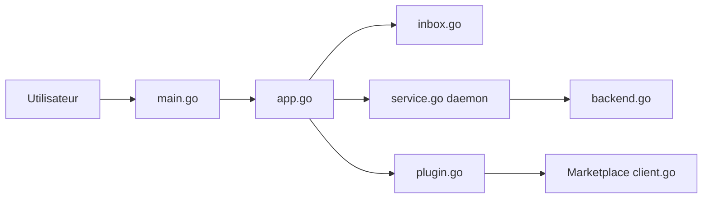

# floatpane/matcha

> Terminal email client, in Go and Bubble Tea, multi-account, with plugins.

## The problem
Reading and writing mail from a terminal requires aging, hard-to-extend clients.

## What it actually does
The README is short. The code shows a TUI client with search, HTML/Markdown message view, sending, export, encryption, a mailbox daemon, JMAP, Maildir and POP3 providers, and a plugin system with a marketplace (35+ plugins announced). A v1 branch is in progress.

## How it is wired


## Trying it
```bash
matcha marketplace
matcha install <url_or_file>
matcha config <plugin_name>
matcha --debug daemon status
```

## Cost and gotchas
Free. v1 is under development; v0 only receives fixes. No basic install command in the provided README.

## What it is not
Not a mail automation tool nor a hosted service.

## Alternatives
No alternative cited in the README.

## For you
Ignore: personal email client, unrelated to data, AI or MLOps.
