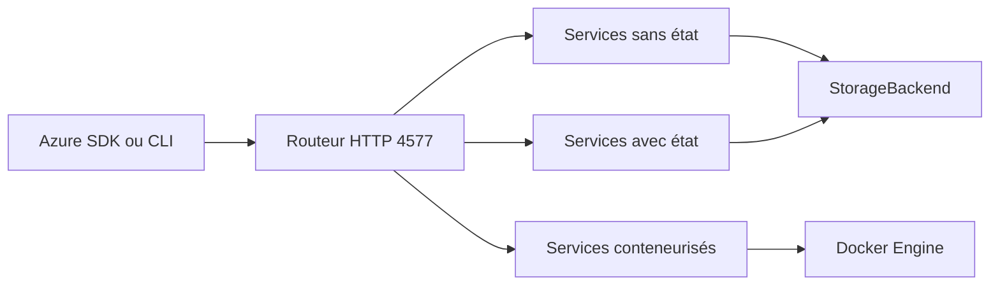

# floci-io/floci-az

> Single-container local Azure emulator for developing and testing in CI without a cloud account.

## The problem
Testing Azure code (storage, Functions, Cosmos DB, Key Vault) means paying for a cloud account or juggling several partial emulators.

## What it actually does
Exposes Azure-compatible APIs on port 4577: Blob, Queue, Table, Functions, Key Vault, Event Hubs, Service Bus, Cosmos DB, SQL, Redis, AKS, Entra ID and others. Heavy services rely on real containers (MongoDB, Citus, ScyllaDB, k3s). Storage is in-memory, persistent, hybrid or WAL. SharedKey credentials are not validated.

## How it is wired


## Trying it
```bash
docker run -d --name floci-az \
  -p 4577:4577 \
  -v /var/run/docker.sock:/var/run/docker.sock \
  floci/floci-az:latest
```

## Cost and gotchas
Free, no account. The Docker socket is required for Functions and the containerized engines, which gives the service broad access to Docker. Terraform (azurerm) and the Cosmos Java SDK require TLS, through an option to enable.

## What it is not
Not a faithful replica of Azure: no RU/s, no multi-region replication, no full APIM policies. No Data Explorer interface like the official Cosmos emulator.

## Alternatives
- Azurite: emulates storage only, but is official.
- Azure Cosmos DB Emulator: better Cosmos fidelity, with an interface, but heavy and Windows-centric.
- Functions Core Tools: covers Functions only.

## For you
Worth watching: useful for testing Azure data pipelines in CI without a bill, but young and with partial fidelity.
