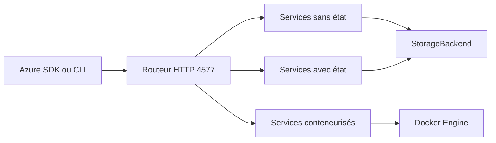

# floci-io/floci-az

> Émulateur Azure local en un seul conteneur pour développer et tester en CI sans compte cloud.

## Le problème
Tester du code Azure (stockage, Functions, Cosmos DB, Key Vault) oblige à payer un compte cloud ou à jongler avec plusieurs émulateurs partiels.

## Ce que ça fait vraiment
Expose sur le port 4577 des API compatibles Azure : Blob, Queue, Table, Functions, Key Vault, Event Hubs, Service Bus, Cosmos DB, SQL, Redis, AKS, Entra ID et d'autres. Les services lourds s'appuient sur de vrais conteneurs (MongoDB, Citus, ScyllaDB, k3s). Stockage en mémoire, persistant, hybride ou WAL. Les identifiants SharedKey ne sont pas validés.

## Comment c'est branché


## Essayer
```bash
docker run -d --name floci-az \
  -p 4577:4577 \
  -v /var/run/docker.sock:/var/run/docker.sock \
  floci/floci-az:latest
```

## Coût et pièges
Gratuit, sans compte. Le socket Docker est nécessaire pour Functions et les moteurs en conteneur, ce qui donne au service un accès large à Docker. Terraform (azurerm) et le SDK Java de Cosmos exigent TLS, via une option à activer.

## Ce que ce n'est pas
Pas une réplique fidèle d'Azure : pas de RU/s, de réplication multi-région ni de politique APIM complète. Pas d'interface Data Explorer comme l'émulateur Cosmos officiel.

## Alternatives
- Azurite : n'émule que le stockage, mais officiel.
- Azure Cosmos DB Emulator : meilleure fidélité Cosmos, avec interface, mais lourd et centré Windows.
- Functions Core Tools : couvre uniquement les Functions.

## Pour toi
À surveiller : utile pour tester en CI des pipelines de données Azure sans facture, mais jeune et à fidélité partielle.

