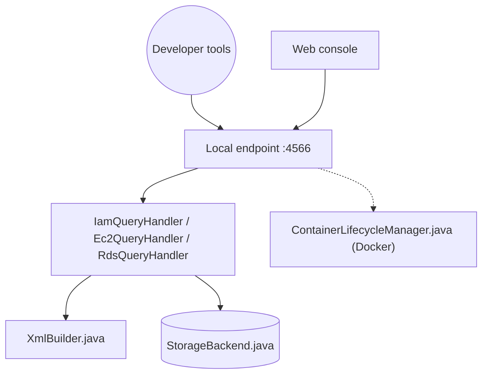

# floci-io/floci

> Free local AWS emulator for developers and CI, a direct replacement for LocalStack Community.

## The problem
Testing AWS code without a cloud account or a bill. LocalStack Community now requires an auth token, according to the README.

## What it actually does
- Exposes AWS services on `http://localhost:4566`; SDKs, CLI, Terraform, CDK or OpenTofu plug into it.
- Stateless services (SQS, SNS, IAM, KMS, etc.) and S3/DynamoDB handled internally; Lambda, RDS, EKS, OpenSearch and others launch real Docker containers.
- Four storage modes: memory, persistent, hybrid, wal.
- Multi-account isolation: a 12-digit access key serves as the account ID.

## How it is wired


## Trying it
```bash
floci start
eval $(floci env)
aws s3 mb s3://my-bucket
aws dynamodb list-tables
# ou : docker compose up  (image floci/floci:latest, port 4566)
```

## Cost and gotchas
Free, no account. Docker-backed services require the Docker socket to be mounted. The performance figures (~24 ms, ~13 MiB) come from the README, not verified here.

## What it is not
Not AWS: "AWS-shaped", fidelity depends on the service. The README lists 2,576 compatibility tests, not a guarantee of parity. The web console launches a sidecar container.

## Alternatives
- LocalStack Community: the historical reference, but an auth token is required according to the README.
- hectorvent/floci: former repo of the image, which no longer receives updates.

## For you
Adopt it to test MLOps pipelines (S3, SQS, Lambda, Bedrock Runtime) in CI without an AWS account: MIT, active, migration from LocalStack by simply changing the image.
