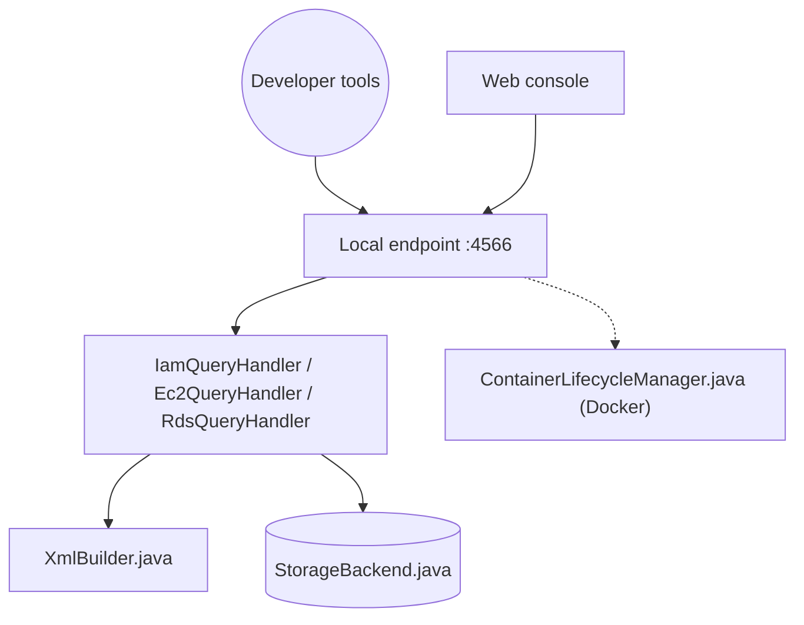

# floci-io/floci

> Émulateur AWS local gratuit pour développeurs et CI, remplaçant direct de LocalStack Community.

## Le problème
Tester du code AWS sans compte cloud ni facture. LocalStack Community demande désormais un jeton d'authentification, d'après le README.

## Ce que ça fait vraiment
- Expose des services AWS sur `http://localhost:4566` ; SDK, CLI, Terraform, CDK ou OpenTofu s'y branchent.
- Services sans état (SQS, SNS, IAM, KMS, etc.) et S3/DynamoDB gérés en interne ; Lambda, RDS, EKS, OpenSearch et d'autres lancent de vrais conteneurs Docker.
- Quatre modes de stockage : memory, persistent, hybrid, wal.
- Isolation multi-comptes : une clé d'accès de 12 chiffres sert d'ID de compte.

## Comment c'est branché


## Essayer
```bash
floci start
eval $(floci env)
aws s3 mb s3://my-bucket
aws dynamodb list-tables
# ou : docker compose up  (image floci/floci:latest, port 4566)
```

## Coût et pièges
Gratuit, aucun compte. Les services adossés à Docker exigent le socket Docker monté. Les chiffres de performance (~24 ms, ~13 MiB) viennent du README, non vérifiés ici.

## Ce que ce n'est pas
Pas AWS : « AWS-shaped », la fidélité dépend du service. Le README liste 2 576 tests de compatibilité, pas une garantie de parité. La console web lance un conteneur sidecar.

## Alternatives
- LocalStack Community : référence historique, mais jeton d'authentification requis selon le README.
- hectorvent/floci : ancien dépôt de l'image, qui ne reçoit plus de mises à jour.

## Pour toi
À adopter pour tester des pipelines MLOps (S3, SQS, Lambda, Bedrock Runtime) en CI sans compte AWS : MIT, actif, migration depuis LocalStack par simple changement d'image.

