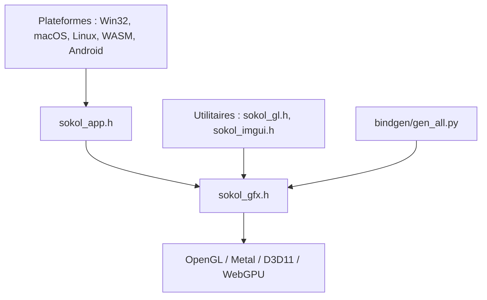

# floooh/sokol

> Small header-only C libraries for graphics, windowing, audio and timing, cross-platform, for game developers.

## The problem
Integrating a portable graphics and windowing layer into a C or C++ project without dragging in a large framework.

## What it actually does
Standalone C headers: sokol_gfx.h wraps GL, Metal, D3D11 and WebGPU; sokol_app.h handles window and input; sokol_audio.h, sokol_fetch.h, sokol_time.h and sokol_args.h cover the rest. Bindings (Zig, Odin, Nim, Rust, D, Jai, C3) are generated automatically from the C headers.

## How it is wired

## Trying it
No command documented: you include the headers (sokol_app.h, sokol_gfx.h, sokol_log.h) in your C code and compile them with your own build system.

## Cost and gotchas
Free. It needs a C compiler and, for shaders, the sokol-shdc tool; Vulkan support is marked experimental.

## What it is not
Not a game engine: no scenes, no editor. sokol_gfx does not create the window and does not translate shaders from one dialect to another.

## Alternatives
No alternative named in the README.

## For you
Ignore: a low-level library for games and real-time rendering, unrelated to data, AI or MLOps work.
