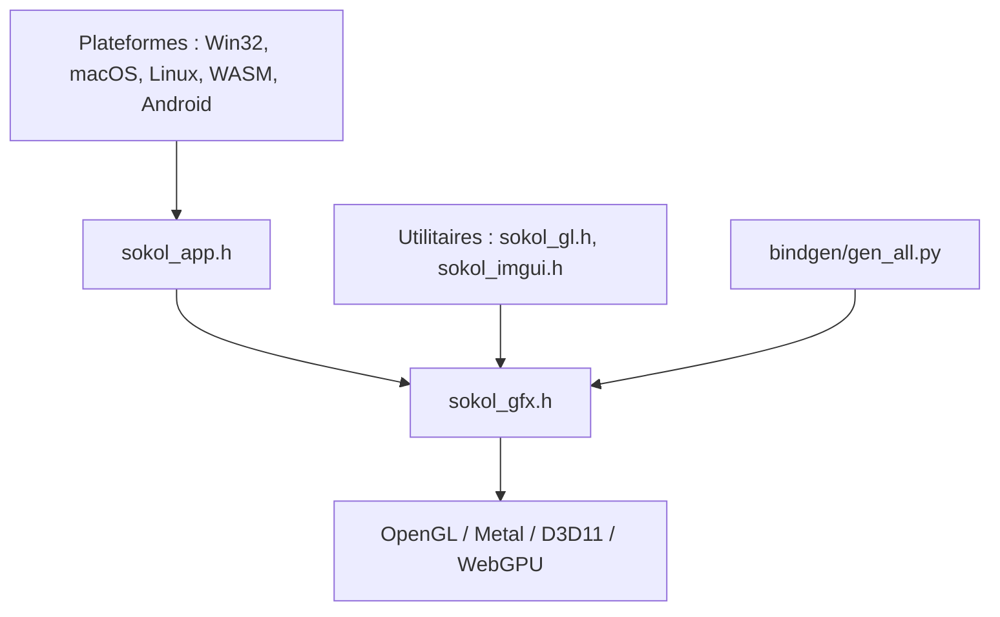

# floooh/sokol

> Petites bibliothèques C en en-têtes seuls pour graphismes, fenêtre, audio et temps, multiplateformes, pour développeurs de jeux.

## Le problème
Intégrer une couche graphique et fenêtrage portable dans un projet C ou C++ sans traîner un gros framework.

## Ce que ça fait vraiment
Des en-têtes C autonomes : sokol_gfx.h enveloppe GL, Metal, D3D11 et WebGPU ; sokol_app.h gère fenêtre et entrées ; sokol_audio.h, sokol_fetch.h, sokol_time.h et sokol_args.h couvrent le reste. Des bindings (Zig, Odin, Nim, Rust, D, Jai, C3) sont générés automatiquement depuis les en-têtes C.

## Comment c'est branché

## Essayer
Aucune commande documentée : on inclut les en-têtes (sokol_app.h, sokol_gfx.h, sokol_log.h) dans son code C et on les compile avec son propre système de build.

## Coût et pièges
Gratuit. Il faut un compilateur C et, pour les shaders, l'outil sokol-shdc ; le support Vulkan est marqué expérimental.

## Ce que ce n'est pas
Pas un moteur de jeu : aucune scène, aucun éditeur. sokol_gfx ne crée pas la fenêtre et ne traduit pas les shaders d'un dialecte à l'autre.

## Alternatives
Aucune alternative nommée dans le README.

## Pour toi
À ignorer : bibliothèque de bas niveau pour jeux et rendu temps réel, sans lien avec un travail data, IA ou MLOps.

