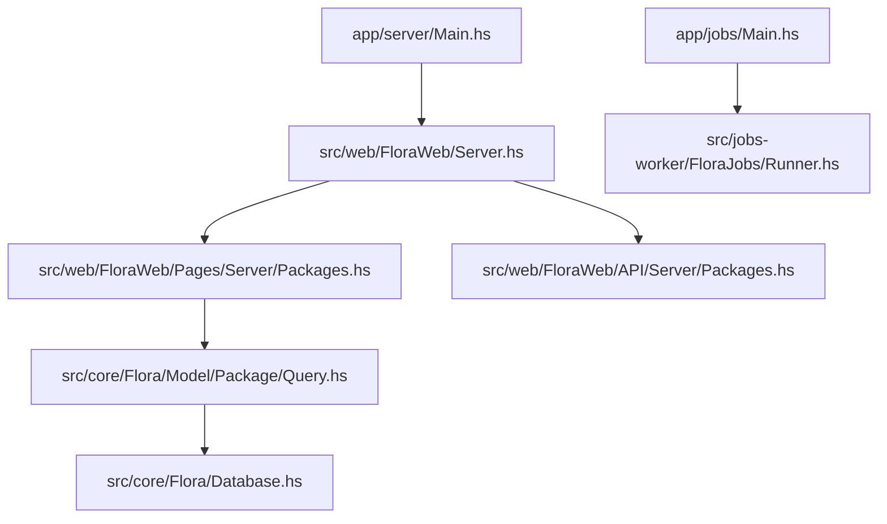

# flora-pm/flora-server

> Server for a meta-index of Haskell packages with categories, namespaces and a mobile interface.

## The problem
The Hackage catalogue contains duplicates and lacks organized categories.

## What it actually does
A web server exposes pages and APIs that query the package model, which accesses PostgreSQL. One jobs executable imports packages in the background, another applies the SQL migrations. Features: categories, namespaces, light/dark theme.

## How it is wired

## Trying it
No command in the README (guides on docs.flora.pm).

## Cost and gotchas
PostgreSQL required; Docker not documented in the README. A civil clause refuses donations and partnerships tied to war or surveillance.

## What it is not
Not a replacement for Hackage nor a build tool: a search index.

## Alternatives
Hackage (implicit, not named).

## For you
Ignore: Haskell package index, no data/AI use.
