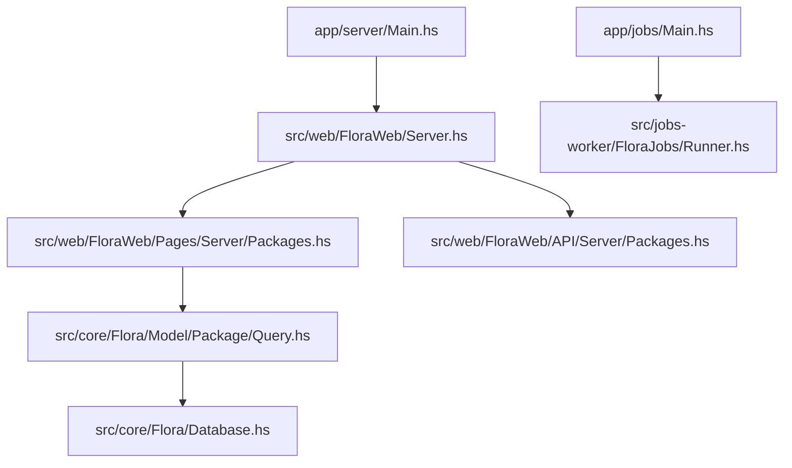

# flora-pm/flora-server

> Serveur d'un méta-index de paquets Haskell avec catégories, espaces de noms et interface mobile.

## Le problème
Le catalogue Hackage contient des doublons et manque de catégories organisées.

## Ce que ça fait vraiment
Un serveur web expose pages et API qui interrogent le modèle de paquets, lequel accède à PostgreSQL. Un exécutable de jobs importe les paquets en arrière-plan, un autre applique les migrations SQL. Fonctions : catégories, espaces de noms, thème clair/sombre.

## Comment c'est branché

## Essayer
Aucune commande dans le README (guides sur docs.flora.pm).

## Coût et pièges
PostgreSQL requis ; Docker non documenté dans le README. Une clause civile refuse dons et partenariats liés à la guerre ou à la surveillance.

## Ce que ce n'est pas
Pas un remplaçant de Hackage ni un outil de build : un index de recherche.

## Alternatives
Hackage (implicite, non nommé).

## Pour toi
À ignorer : index de paquets Haskell, aucun usage data/IA.

