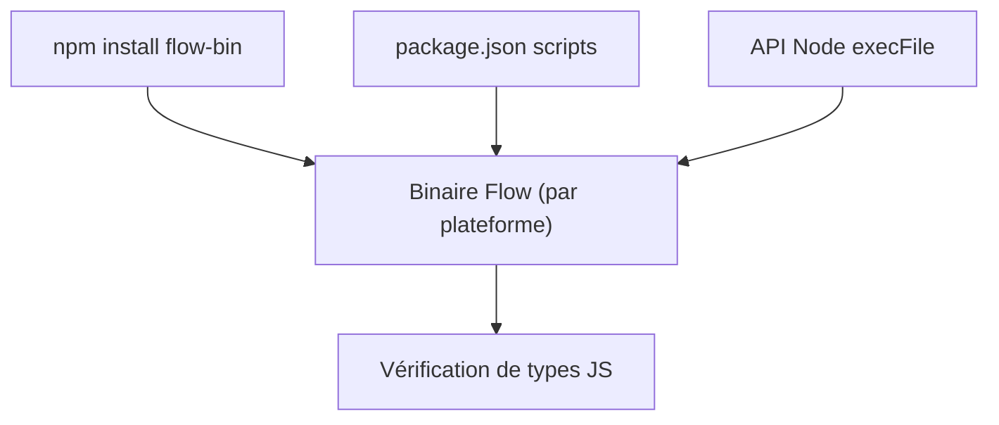

# flow/flow-bin

> npm wrapper for the Flow binaries, a static type checker for JavaScript.

## The problem
Installing Flow via npm requires fetching the right binary for each platform.

## What it actually does
An npm package that ships the Flow binaries (macOS arm64, Linux x64 and arm64, Windows x64) and exposes an API to launch it from Node. Development has moved to facebook/flow, under packages/flow-bin.

## How it is wired
Simplified diagram based on the sheet, no diagram provided.


## Trying it
```bash
yarn add --dev flow-bin
yarn run flow --help
npm install --save-dev flow-bin
npm run flow --help
```

## Cost and gotchas
Archived repository: development is in facebook/flow. License not identified.

## What it is not
Not Flow itself: only the packaging of the binaries.

## Alternatives
- facebook/flow (new location of development).

## For you
Ignore: archived repository; if you need Flow, use the facebook/flow repository.
