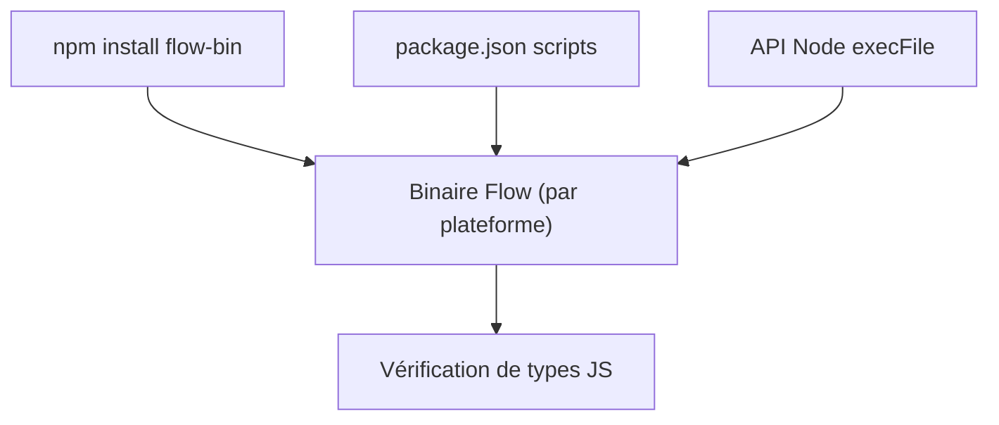

# flow/flow-bin

> Enveloppe npm des binaires de Flow, vérificateur de types statique pour JavaScript.

## Le problème
Installer Flow via npm demande de récupérer le bon binaire selon la plateforme.

## Ce que ça fait vraiment
Paquet npm qui livre les binaires de Flow (macOS arm64, Linux x64 et arm64, Windows x64) et expose une API pour le lancer depuis Node. Le développement a déménagé vers facebook/flow, sous packages/flow-bin.

## Comment c'est branché
Schéma simplifié d'après la fiche, sans diagramme fourni.


## Essayer
```bash
yarn add --dev flow-bin
yarn run flow --help
npm install --save-dev flow-bin
npm run flow --help
```

## Coût et pièges
Dépôt archivé : le développement est dans facebook/flow. Licence non identifiée.

## Ce que ce n'est pas
Pas Flow lui-même : seulement l'emballage des binaires.

## Alternatives
- facebook/flow (nouvel emplacement du développement).

## Pour toi
À ignorer : dépôt archivé ; si tu as besoin de Flow, prends le dépôt facebook/flow.

