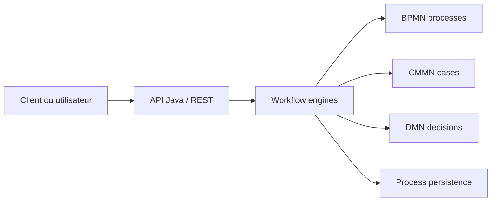

# flowable/flowable-engine

> Java engine for BPMN processes, CMMN cases and DMN rules, embeddable or run as a service.

## The problem
Orchestrating human and system activities (approvals, case files, decisions) without hand-writing a state machine and its history.

## What it actually does
Three Java engines: BPMN processes, CMMN cases, DMN rules. It runs embedded in an application (Spring integration) or as a server, with a Java API and REST. The sampled code confirms a shared command/session infrastructure, persistence of entities and events, and job polling for external workers.

## How it is wired


## Trying it
```bash
java -version
```
The README only documents this JDK check (17+ for V7) and points to the website for downloads.

## Cost and gotchas
Free, Apache-2.0. JDK 17+ for V7 (V6 is still maintained for Java 8+). The "Flowable Design" modeling tool requires creating an account.

## What it is not
Not a data pipeline orchestrator or a DAG-style scheduler: it is BPM for business users. The README does not establish the internal wiring between engines.

## Alternatives
No alternative named in the README.

## For you
Keep an eye on it: useful if an AI project requires a human approval circuit or traceable business rules in Java, out of scope otherwise.
