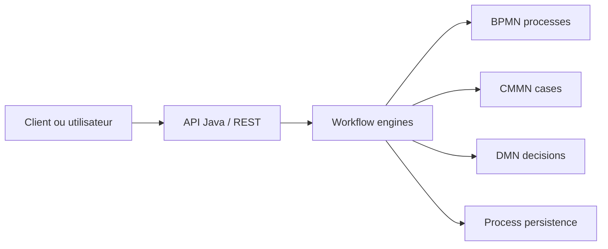

# flowable/flowable-engine

> Moteur Java de processus BPMN, de cas CMMN et de règles DMN, embarquable ou en service.

## Le problème
Orchestrer des activités humaines et système (validations, dossiers, décisions) sans réécrire à la main une machine à états et son historique.

## Ce que ça fait vraiment
Trois moteurs Java : processus BPMN, cas CMMN, règles DMN. Il tourne embarqué dans une application (intégration Spring) ou comme serveur, avec API Java et REST. Le code échantillonné confirme une infrastructure de commandes/sessions partagée, la persistance des entités et des événements, et l'interrogation de jobs pour workers externes.

## Comment c'est branché


## Essayer
```bash
java -version
```
Le README ne documente que cette vérification du JDK (17+ pour la V7) et renvoie au site pour les téléchargements.

## Coût et pièges
Gratuit, Apache-2.0. JDK 17+ pour la V7 (la V6 reste maintenue pour Java 8+). L'outil de modélisation « Flowable Design » passe par un compte à créer.

## Ce que ce n'est pas
Pas un orchestrateur de pipelines de données ni un ordonnanceur type DAG : c'est du BPM pour métiers. Le câblage interne entre moteurs n'est pas établi par le README.

## Alternatives
Aucune alternative nommée dans le README.

## Pour toi
Surveiller : utile si un projet IA impose un circuit de validation humaine ou des règles métier traçables en Java, hors périmètre sinon.

