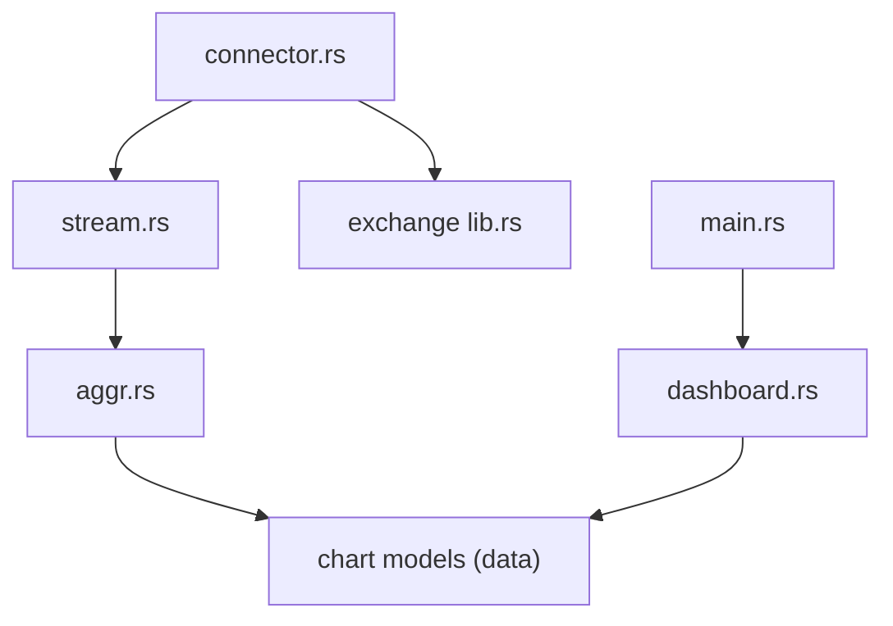

# flowsurface-rs/flowsurface

> Native desktop application for charting live crypto markets, for traders.

## The problem
Trade and order-book streams from exchanges are hard to read without a dedicated tool.

## What it actually does
It connects to the WebSocket feeds of Binance, Bybit, Hyperliquid, OKX and MEXC. It displays candlesticks with footprints and profiles, order book (DOM), historical heatmap, time and sales, scriptable indicators and sounds triggered by trades. Layouts are saved. An optional server mode fetches trade history.

## How it is wired


## Trying it
```bash
cargo install --git https://github.com/flowsurface-rs/flowsurface flowsurface
flowsurface
```

## Cost and gotchas
Free, no account. Building with Rust is possible, with audio libraries on Linux. The macOS app is not notarized. The indicator catalog contacts api.flowsurface.com; the README states no telemetry.

## What it is not
It is not a trading bot: it is a visualization tool.

## Alternatives
The README cites Kraken Desktop (formerly Cryptowatch) as inspiration.

## For you
Ignore: trading-oriented, with no direct link to your work; interesting only as an example of a Rust application with real-time streams.
