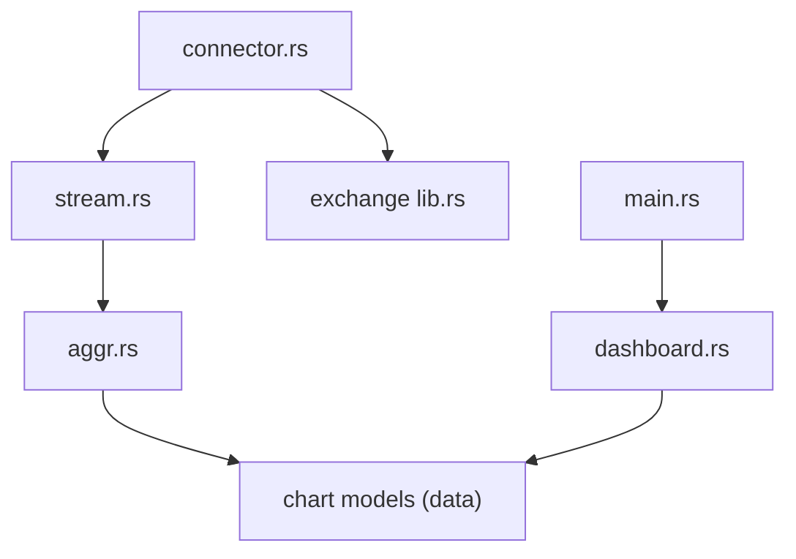

# flowsurface-rs/flowsurface

> Application de bureau native pour tracer les marchés crypto en direct, pour traders.

## Le problème
Les flux de trades et de carnets d'ordres des plateformes sont difficiles à lire sans outil dédié.

## Ce que ça fait vraiment
Elle se connecte aux flux WebSocket de Binance, Bybit, Hyperliquid, OKX et MEXC. Elle affiche chandeliers avec empreintes et profils, carnet (DOM), heatmap historique, time and sales, indicateurs scriptables et sons déclenchés par les trades. Les mises en page sont sauvegardées. Un mode serveur optionnel récupère l'historique des trades.

## Comment c'est branché


## Essayer
```bash
cargo install --git https://github.com/flowsurface-rs/flowsurface flowsurface
flowsurface
```

## Coût et pièges
Gratuit, sans compte. Compilation Rust possible, avec bibliothèques audio sous Linux. L'application macOS n'est pas notarisée. Le catalogue d'indicateurs contacte api.flowsurface.com ; le README annonce aucune télémétrie.

## Ce que ce n'est pas
Ce n'est pas un robot de trading : c'est un outil de visualisation.

## Alternatives
Le README cite Kraken Desktop (ex Cryptowatch) comme inspiration.

## Pour toi
À ignorer : orienté trading, sans lien direct avec ton métier ; intéressant seulement comme exemple d'application Rust avec flux temps réel.

