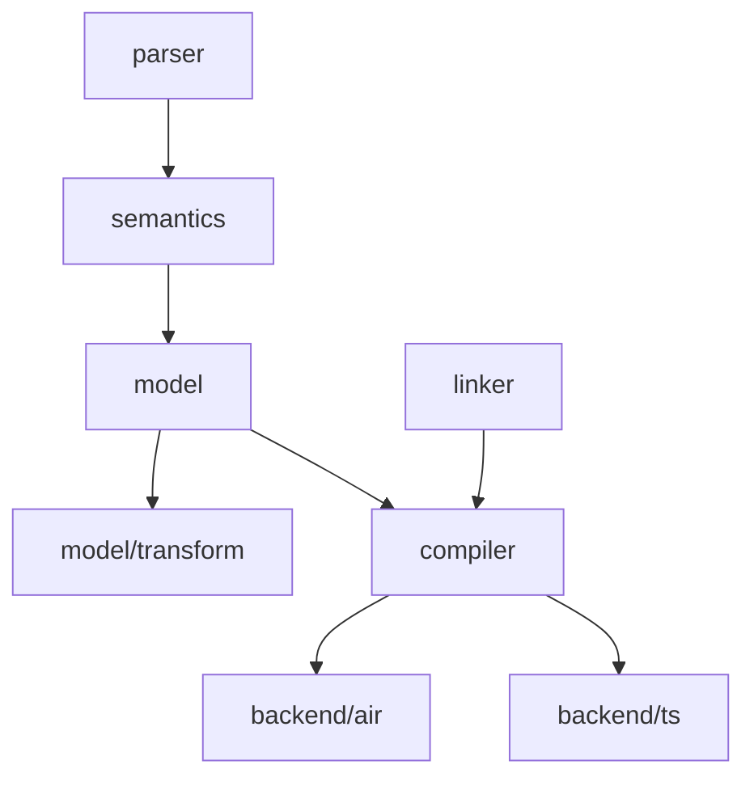

# fluencelabs/aqua

> Language for coordinating peer-to-peer distributed workflows, at the heart of the Fluence protocol.

## The problem
Coordinating functions spread across several peers, with no central server, requires writing the network logic by hand.

## What it actually does
Aqua programs run across several peers, sequentially or in parallel. The compiler chains parser, semantics, intermediate model, linker and backend (AIR code or TypeScript wrappers for the Fluence JS SDK).

## How it is wired

## Trying it
The README points to the Fluence CLI (`aqua` command) and to USAGE.md, with no explicit command.

## Cost and gotchas
Archived repository, last push in September 2024. Depends on the Fluence ecosystem.

## What it is not
Not a data workflow orchestrator like Airflow: it is a language for peer-to-peer networks.

## Alternatives
No alternative named.

## For you
Ignore: archived, and unrelated to data/MLOps pipelines.
