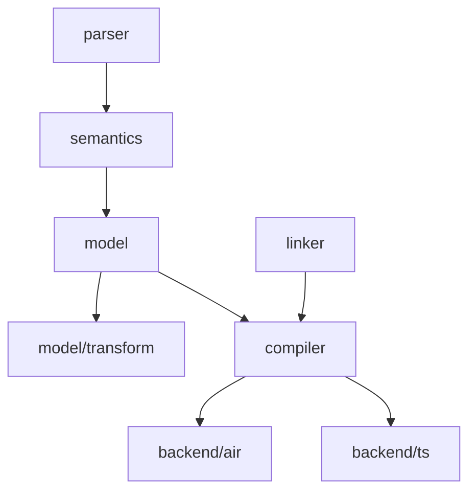

# fluencelabs/aqua

> Langage de coordination de workflows distribués en pair à pair, au cœur du protocole Fluence.

## Le problème
Coordonner des fonctions réparties sur plusieurs pairs, sans serveur central, demande d'écrire la logique réseau à la main.

## Ce que ça fait vraiment
Les programmes Aqua s'exécutent sur plusieurs pairs, en séquence ou en parallèle. Le compilateur enchaîne parseur, sémantique, modèle intermédiaire, éditeur de liens et backend (code AIR ou wrappers TypeScript pour le SDK JS Fluence).

## Comment c'est branché

## Essayer
Le README renvoie à la CLI Fluence (commande `aqua`) et à USAGE.md, sans commande explicite.

## Coût et pièges
Dépôt archivé, dernier push en septembre 2024. Dépend de l'écosystème Fluence.

## Ce que ce n'est pas
Pas un orchestrateur de workflows de données comme Airflow : c'est un langage pour réseaux pair à pair.

## Alternatives
Aucune alternative nommée.

## Pour toi
À ignorer : archivé, et sans lien avec les pipelines data/MLOps.

