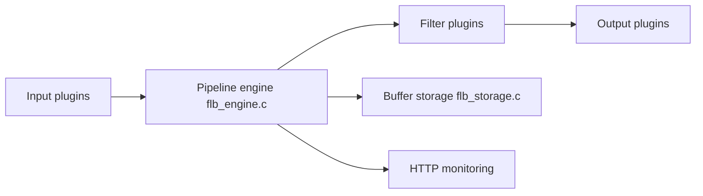

# fluent/fluent-bit

> Lightweight agent that collects, transforms and ships logs, metrics and traces to any destination.

## The problem
Logs and metrics from dozens of sources must reach several backends without wasting CPU and RAM on every node.

## What it actually does
A modular pipeline: input plugins, filters (including Lua), output plugins (C or Go), with disk buffering (`flb_storage.c`) and an internal engine (`flb_engine.c`). Streaming SQL processing, metrics exposed over HTTP/Prometheus, built-in TLS. More than 70 native plugins according to the README.

## How it is wired


## Trying it
```bash
cd build
cmake ..
make
bin/fluent-bit -i cpu -o stdout -f 1
```
Linux packages, Docker images and Windows binaries also exist (README).

## Cost and gotchas
Free. Building requires CMake ≥ 3.0, Flex, Bison, YAML and OpenSSL headers. 803 open issues.

## What it is not
Not an observability platform: it neither stores nor displays anything. Not an analytics engine, despite the streaming SQL.

## Alternatives
Fluentd, whose ecosystem it belongs to: heavier but richer in plugins (from reading the README, not detailed).

## For you
Adopt it to route ML job logs and metrics to your observability stack: graduated CNCF project, active, small footprint.
