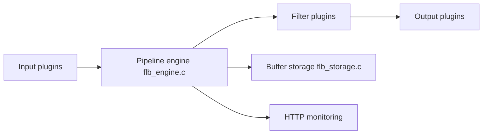

# fluent/fluent-bit

> Agent léger qui collecte, transforme et expédie logs, métriques et traces vers n'importe quelle destination.

## Le problème
Les logs et métriques de dizaines de sources doivent atteindre plusieurs backends sans gaspiller CPU et RAM sur chaque nœud.

## Ce que ça fait vraiment
Un pipeline modulaire : plugins d'entrée, filtres (dont Lua), plugins de sortie (C ou Go), avec buffer disque (`flb_storage.c`) et moteur interne (`flb_engine.c`). Traitement SQL en flux, métriques exposées en HTTP/Prometheus, TLS intégré. Plus de 70 plugins natifs selon le README.

## Comment c'est branché


## Essayer
```bash
cd build
cmake ..
make
bin/fluent-bit -i cpu -o stdout -f 1
```
Des paquets Linux, images Docker et binaires Windows existent aussi (README).

## Coût et pièges
Gratuit. Compilation : CMake ≥ 3.0, Flex, Bison, en-têtes YAML et OpenSSL. 803 issues ouvertes.

## Ce que ce n'est pas
Pas une plateforme d'observabilité : il ne stocke ni n'affiche rien. Pas un moteur d'analyse, malgré le SQL en flux.

## Alternatives
Fluentd, dont il fait partie de l'écosystème : plus lourd mais plus riche en plugins (lecture du README, non détaillé).

## Pour toi
À adopter pour acheminer logs de jobs ML et métriques vers ta stack d'observabilité : projet CNCF gradué, actif, empreinte faible.

