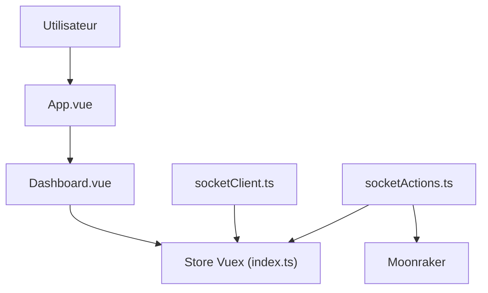

# fluidd-core/fluidd

> Free web interface for controlling a 3D printer running Klipper.

## The problem
Controlling a Klipper printer from the command line is impractical.

## What it actually does
A Vue application that talks to Moonraker over WebSocket: printer status, print head, console, file management, G-code preview, cameras, history, timelapse, MMU and AFC mapping. Movable layouts, themes, multiple printers.

## How it is wired


## Trying it
```bash
# Aucune commande documentée dans le README : installation recommandée par KIAUH.
```

## Cost and gotchas
Free, GPL-3.0. Assumes a printer running Klipper, with Moonraker installed (KIAUH installs the whole stack).

## What it is not
Not a slicer or a firmware: an interface for Klipper and Moonraker.

## Alternatives
Mainsail, which the README cites via MainsailOS, as another Klipper interface from the same community.

## For you
Ignore: a 3D printer interface, unrelated to data, AI or MLOps work.
