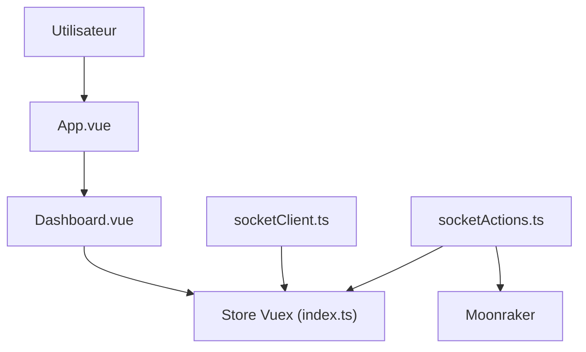

# fluidd-core/fluidd

> Interface web libre pour piloter une imprimante 3D sous Klipper.

## Le problème
Piloter une imprimante Klipper en ligne de commande est peu pratique.

## Ce que ça fait vraiment
Application Vue qui parle à Moonraker par WebSocket : état de l'imprimante, tête d'impression, console, gestion de fichiers, aperçu G-code, caméras, historique, timelapse, mappage MMU et AFC. Mises en page déplaçables, thèmes, plusieurs imprimantes.

## Comment c'est branché


## Essayer
```bash
# Aucune commande documentée dans le README : installation recommandée par KIAUH.
```

## Coût et pièges
Gratuit, GPL-3.0. Suppose une imprimante sous Klipper, avec Moonraker installé (KIAUH installe l'ensemble).

## Ce que ce n'est pas
Pas un trancheur ni un firmware : une interface pour Klipper et Moonraker.

## Alternatives
Mainsail, que le README cite via MainsailOS, comme autre interface Klipper de la même communauté.

## Pour toi
À ignorer : interface d'imprimante 3D, sans lien avec un travail data, IA ou MLOps.

