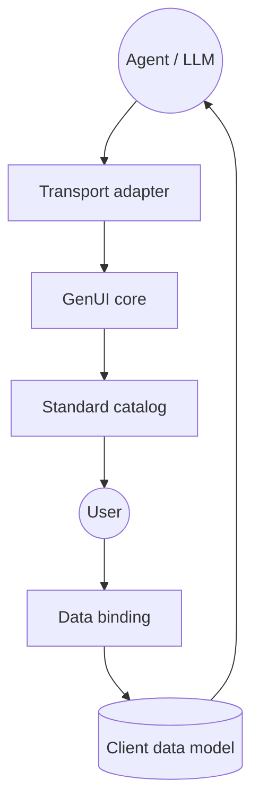

# flutter/genui

> Flutter SDK that renders interactive interfaces from JSON produced by an LLM agent.

## The problem
Agents answer with walls of text; describing a form or a carousel in prose is slow and barely interactive.

## What it actually does
The agent returns JSON, and the SDK renders it with your app's widget catalog (not generated code). State changes are sent back to the agent. Handles data binding, chat and canvas UX, custom widgets, the A2UI protocol. Packages: genui, genui_a2a, genai_primitives, json_schema_builder.

## How it is wired


## Trying it
```bash
npx skills add https://github.com/flutter/genui/tree/main/packages/genui/skills
```
Flutter >= 3.35.7 required; otherwise see the linked getting-started guide.

## Cost and gotchas
You need an LLM provider (for example firebase_ai or dartantic_ai): the call is at your expense. The API changes "sometimes radically".

## What it is not
Not stable: a rework into `a2ui_core`, `a2ui_agent`, `a2ui_flutter` with a different API has been announced. Not a code generator.

## Alternatives
No alternative named; the new `a2ui_*` packages are the announced successor.

## For you
Worth watching: an interesting idea for agents with a UI, but experimental and being reworked; wait for the a2ui packages.
