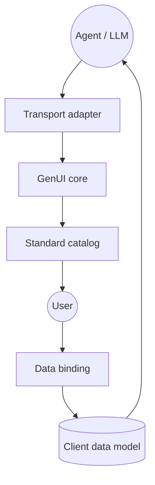

# flutter/genui

> SDK Flutter qui rend des interfaces interactives à partir du JSON produit par un agent LLM.

## Le problème
Les agents répondent par des murs de texte ; décrire un formulaire ou un carrousel en prose est lent et peu interactif.

## Ce que ça fait vraiment
L'agent renvoie du JSON, le SDK le rend avec le catalogue de widgets de ton app (pas du code généré). Les changements d'état sont renvoyés à l'agent. Gère liaison de données, UX chat et canvas, widgets personnalisés, protocole A2UI. Paquets : genui, genui_a2a, genai_primitives, json_schema_builder.

## Comment c'est branché


## Essayer
```bash
npx skills add https://github.com/flutter/genui/tree/main/packages/genui/skills
```
Flutter >= 3.35.7 requis ; sinon voir le guide de démarrage lié.

## Coût et pièges
Il faut un fournisseur LLM (par exemple firebase_ai ou dartantic_ai) : l'appel est à ta charge. L'API change « parfois radicalement ».

## Ce que ce n'est pas
Pas stable : annonce d'une refonte en `a2ui_core`, `a2ui_agent`, `a2ui_flutter` avec une API différente. Pas un générateur de code.

## Alternatives
Aucune alternative nommée ; les nouveaux paquets `a2ui_*` sont la suite annoncée.

## Pour toi
Surveiller : idée intéressante pour des agents avec UI, mais expérimental et en cours de refonte ; attendre les paquets a2ui.

