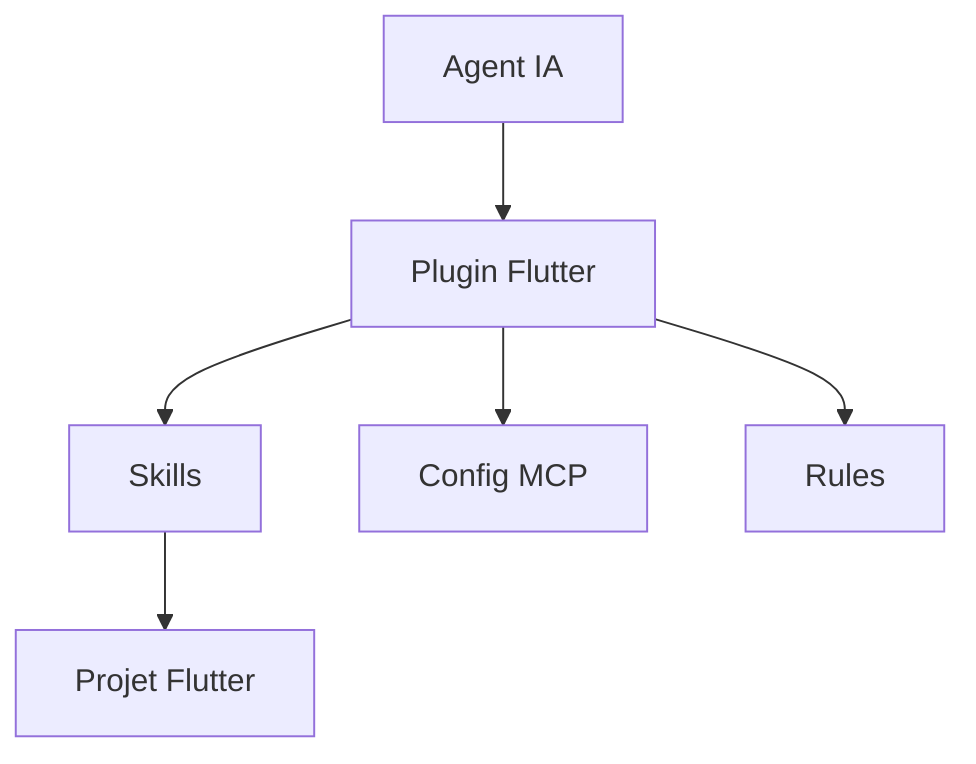

# flutter/skills

> AI agent plugins from the Flutter team: skills, MCP config and rules for developing in Flutter.

## The problem
A coding agent often gets Flutter best practices wrong for lack of reproducible procedures.

## What it actually does
A collection of plugins bundling Agent Skills (folders of files that teach the agent "how" to do a task), MCP server config and rules. Ten skills listed: integration testing, widget preview, widget testing, layered architecture, adaptive layout, overflow fixing, JSON serialization, declarative routing, localization, the `http` package.

## How it is wired

## Trying it
No commands in the README; it points to "Get started developing with AI" for installation.

## Cost and gotchas
Free; the agent you use (and its subscription) is at your expense. Dart skills can be installed separately.

## What it is not
Not a framework: these are instructions for agents. Limited to Flutter/Dart.

## Alternatives
No alternative named in the README.

## For you
Worth watching: interesting as a model of a skills format maintained by a vendor, but useful only if you do Flutter.
