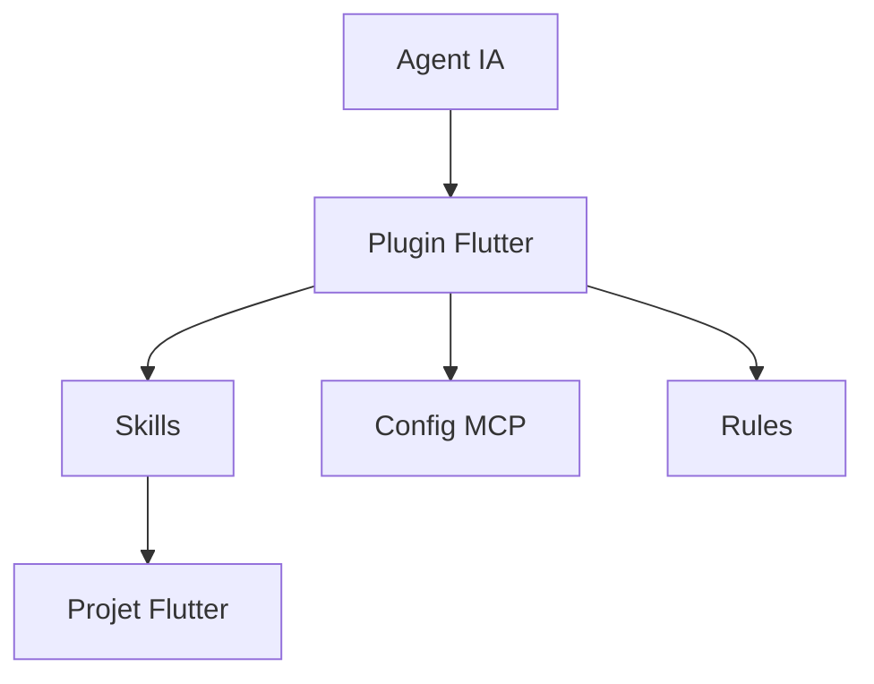

# flutter/skills

> Plugins d'agents IA de l'équipe Flutter : skills, config MCP et règles pour développer en Flutter.

## Le problème
Un agent de code se trompe souvent sur les bonnes pratiques Flutter faute de procédures reproductibles.

## Ce que ça fait vraiment
Collection de plugins regroupant des Agent Skills (dossiers de fichiers qui apprennent à l'agent « comment » faire une tâche), de la config de serveur MCP et des règles. Dix skills listés : test d'intégration, aperçu de widget, test de widget, architecture en couches, mise en page adaptative, correction d'overflow, sérialisation JSON, routage déclaratif, localisation, paquet `http`.

## Comment c'est branché

## Essayer
Aucune commande dans le README ; il renvoie à « Get started developing with AI » pour l'installation.

## Coût et pièges
Gratuit ; l'agent utilisé (et son abonnement) reste à ta charge. Skills Dart installables séparément.

## Ce que ce n'est pas
Pas un framework : ce sont des instructions pour agents. Limité à Flutter/Dart.

## Alternatives
Aucune alternative nommée dans le README.

## Pour toi
À surveiller : intéressant comme modèle de format de skills maintenu par un éditeur, mais utile seulement si tu fais du Flutter.

