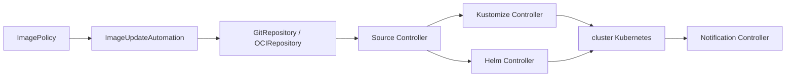

# fluxcd/flux2

> GitOps tool that keeps Kubernetes clusters in sync with Git and OCI artifacts.

## The problem
Deploying with `kubectl apply` from a workstation lets the cluster drift from what is versioned, with no trace of who applied what.

## What it actually does
Synchronizes cluster state with configuration sources: Git repositories, OCI artifacts, Helm repositories and charts, buckets.
Automates configuration updates when new code is ready to deploy, including image updates pushed to Git.
Built on the GitOps Toolkit: composable CRDs and controllers (Source, Kustomize, Helm, Notification, Image Automation).
Supports multi-tenancy and an arbitrary number of synchronized Git repositories.

## How it is wired

## Trying it
No command is documented in the README: it points to the bootstrap guide on fluxcd.io.

## Cost and gotchas
Free, a graduated CNCF project. You must give Flux write access to the Git repository for image automation, and manage secrets — the README points to a SOPS guide for that.

## What it is not
Not a CI: it deploys what is already built and published. Not a single tool but a set of controllers, each with its own CRDs, which you need to understand separately. The README is an index; all the operational content is on fluxcd.io.

## Alternatives
No alternative named in the README.

## For you
If your models and services deploy on Kubernetes, Flux is the clean way to version that state.
