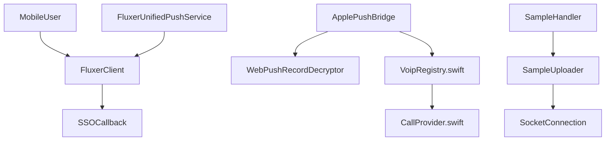

# fluxerapp/flutter_client

> Flutter mobile client (beta) for the Fluxer community messaging app, compatible with self-hosted instances.

## The problem
Using Fluxer from a phone or tablet, including on self-hosted instances.

## What it actually does
- Flutter app for Android and iOS; desktop "in preparation".
- Push notifications: FCM (Android), UnifiedPush/ntfy for the OSS variant, APNs on iOS with decryption of Web Push records.
- Incoming calls via CallKit and screen sharing through an iOS broadcast extension.
- SSO login (OIDC) with the URI `fluxer://auth/sso/callback`.

## How it is wired


## Trying it
```bash
# Pas de commande : installer la bêta
# Android : APK "betafcm" (arm64-v8a) ou "betaoss" + UnifiedPush depuis les releases GitHub
# iOS : TestFlight ; Obtainium pour les builds GitHub
```

## Cost and gotchas
Free, Fluxer account required. Beta: missing or broken features. Notifications from self-hosted instances only work on the Android OSS build; an iOS/FCM relay is not shipped.

## What it is not
Not the Fluxer server. GitHub issues are closed: feedback goes through feedback.fluxer.com. AGPL-3.0 license.

## Alternatives
None named in the README.

## For you
Ignore: consumer messaging app in beta, unrelated to your data / AI / MLOps topics.
