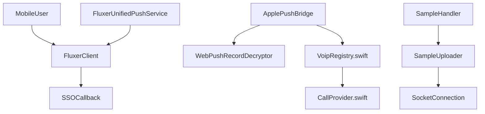

# fluxerapp/flutter_client

> Client mobile Flutter (bêta) de la messagerie communautaire Fluxer, compatible instances auto-hébergées.

## Le problème
Utiliser Fluxer depuis un téléphone ou une tablette, y compris sur des instances auto-hébergées.

## Ce que ça fait vraiment
- Application Flutter pour Android et iOS ; desktop « en préparation ».
- Notifications push : FCM (Android), UnifiedPush/ntfy pour la variante OSS, APNs sur iOS avec déchiffrement des enregistrements Web Push.
- Appels entrants via CallKit et partage d'écran par extension de diffusion iOS.
- Connexion SSO (OIDC) avec l'URI `fluxer://auth/sso/callback`.

## Comment c'est branché


## Essayer
```bash
# Pas de commande : installer la bêta
# Android : APK "betafcm" (arm64-v8a) ou "betaoss" + UnifiedPush depuis les releases GitHub
# iOS : TestFlight ; Obtainium pour les builds GitHub
```

## Coût et pièges
Gratuit, compte Fluxer requis. Bêta : fonctions manquantes ou cassées. Les notifications d'instances auto-hébergées ne marchent que sur la build Android OSS ; un relais iOS/FCM n'est pas livré.

## Ce que ce n'est pas
Pas le serveur Fluxer. Les issues GitHub sont fermées : retours via feedback.fluxer.com. Licence AGPL-3.0.

## Alternatives
Aucune nommée dans le README.

## Pour toi
À ignorer : messagerie grand public en bêta, sans lien avec tes sujets data / IA / MLOps.

