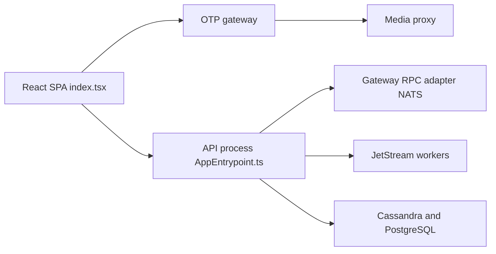

# fluxerapp/fluxer

> Free, self-hostable instant messaging and VoIP, for friends, groups and communities.

## The problem
Popular community messaging platforms are closed and centralized; hosting your own is hard.

## What it actually does
Web (React), desktop (Electron) and mobile clients, a TypeScript API, a real-time gateway in Erlang/OTP, Rust services (messages, media, unfurl), NATS/JetStream, Cassandra and PostgreSQL, voice via LiveKit. The self-hosted composition is in `deploy/self-hosting/docker-compose.yml`. The README sends bug reports to an external site, as GitHub issues are closed.

## How it is wired


## Trying it
```bash
flatpak install flathub app.fluxer.Fluxer
```
Self-hosting: see the online documentation (no command in the README).

## Cost and gotchas
Free. Heavy stack to host (Erlang, Rust, NATS, Cassandra, LiveKit, Stripe, SMTP...). AGPL: code-sharing obligations if a modified service is offered over the network.

## What it is not
Not a data/AI tool. GitHub issues are closed: support goes through a Fluxer account.

## Alternatives
No alternative named in the README.

## For you
Ignore: general-purpose messaging unrelated to your job; the only possible interest would be the architecture, not the usage.
