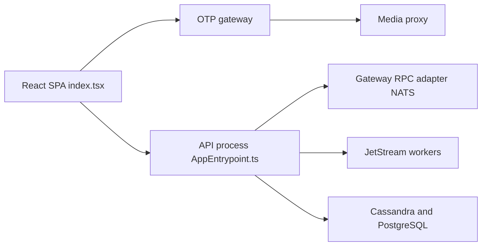

# fluxerapp/fluxer

> Messagerie instantanée et VoIP libre, auto-hébergeable, pour amis, groupes et communautés.

## Le problème
Les messageries communautaires populaires sont fermées et centralisées ; héberger la sienne est difficile.

## Ce que ça fait vraiment
Clients web (React), bureau (Electron) et mobiles, API TypeScript, passerelle temps réel en Erlang/OTP, services Rust (messages, médias, unfurl), NATS/JetStream, Cassandra et PostgreSQL, voix via LiveKit. La composition auto-hébergée est dans `deploy/self-hosting/docker-compose.yml`. Le README renvoie les rapports de bugs vers un site externe, les issues GitHub étant fermées.

## Comment c'est branché


## Essayer
```bash
flatpak install flathub app.fluxer.Fluxer
```
Auto-hébergement : voir la documentation en ligne (aucune commande dans le README).

## Coût et pièges
Gratuit. Pile lourde à héberger (Erlang, Rust, NATS, Cassandra, LiveKit, Stripe, SMTP…). AGPL : obligations de partage du code en cas de service réseau modifié.

## Ce que ce n'est pas
Pas un outil data/IA. Les issues GitHub sont closes : le support passe par un compte Fluxer.

## Alternatives
Aucune alternative nommée dans le README.

## Pour toi
À ignorer : messagerie généraliste sans lien avec ton métier ; l'intérêt éventuel serait l'architecture, pas l'usage.

