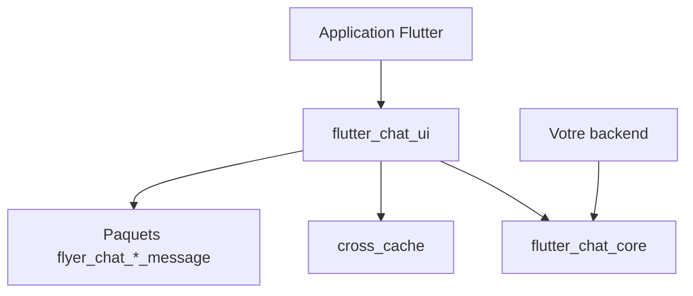

# flyerhq/flutter_chat_ui

> Modular, backend-agnostic Flutter chat UI package.

## The problem
Hand-writing a chat interface (bubbles, message lists, images, files) in a Flutter app takes time.

## What it actually does
A `Chat` widget that plugs into any service. Core packages: flutter_chat_ui, flutter_chat_core, cross_cache. Optional packages for markdown text, progressively streamed text, images, files and system messages. Works on iOS, Android, web, macOS, Windows and Linux.

## How it is wired
Simplified diagram based on the sheet, no diagram provided.



## Trying it
```yaml
dependencies:
  flutter_chat_core: ^2.0.0
  flutter_chat_ui: ^2.0.0
```
Then import and use the `Chat` widget.

## Cost and gotchas
Free. You need a Flutter project and a backend of your choice; full documentation is at flyer.chat.

## What it is not
Not a messaging server: no network part is provided.

## Alternatives
None cited in the README.

## For you
Ignore: it could dress up an LLM assistant as a mobile app, but it is pure Flutter and outside your data / MLOps scope.
