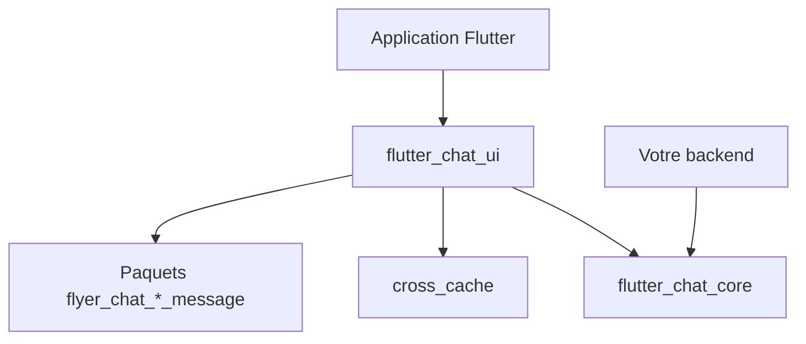

# flyerhq/flutter_chat_ui

> Paquet Flutter d'interface de discussion, modulaire, indépendant du serveur.

## Le problème
Écrire une interface de discussion (bulles, listes de messages, images, fichiers) à la main dans une application Flutter prend du temps.

## Ce que ça fait vraiment
Un widget `Chat` branché sur n'importe quel service. Paquets cœur : flutter_chat_ui, flutter_chat_core, cross_cache. Paquets optionnels pour le texte en markdown, le texte diffusé progressivement, les images, les fichiers et les messages système. Fonctionne sur iOS, Android, web, macOS, Windows et Linux.

## Comment c'est branché
Schéma simplifié d'après la fiche, sans diagramme fourni.



## Essayer
```yaml
dependencies:
  flutter_chat_core: ^2.0.0
  flutter_chat_ui: ^2.0.0
```
Puis importer et utiliser le widget `Chat`.

## Coût et pièges
Gratuit. Il faut un projet Flutter et un backend de ton choix ; la documentation complète est sur flyer.chat.

## Ce que ce n'est pas
Pas un serveur de messagerie : aucune partie réseau n'est fournie.

## Alternatives
Aucune citée dans le README.

## Pour toi
À ignorer : peut servir à habiller un assistant LLM en application mobile, mais c'est du Flutter pur et hors de ton périmètre data / MLOps.

