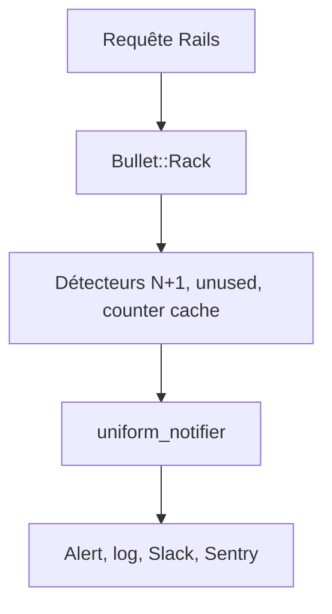

# flyerhzm/bullet

> Ruby on Rails gem that detects N+1 queries and unused eager loading in development.

## The problem
ActiveRecord N+1 queries slow an app down without being visible to the naked eye.

## What it actually does
Watches queries during development and flags: N+1, unused eager loading, need for a counter cache. Notifies via browser alert, `log/bullet.log` log, console, page footer, Sentry, Slack, OpenTelemetry and others. Can make tests fail (`Bullet.raise`). Works with ActiveRecord and Mongoid >= 4.0.

## How it is wired
Simplified diagram based on the sheet, no diagram provided.



## Trying it
```bash
gem install bullet
bundle exec rails g bullet:install
```
```ruby
gem 'bullet', group: 'development'
```

## Cost and gotchas
Free. The real requirement is Ruby and Rails, absent from the prerequisites list: without them, nothing to do. Keep it out of production.

## What it is not
Not a general profiler nor a production monitoring tool. It fixes nothing: it tells you where to add `includes`.

## Alternatives
No alternative named in the README.

## For you
Ignore for a data / AI / MLOps profile unless you maintain a Rails app: the tool is good but outside your stack.
