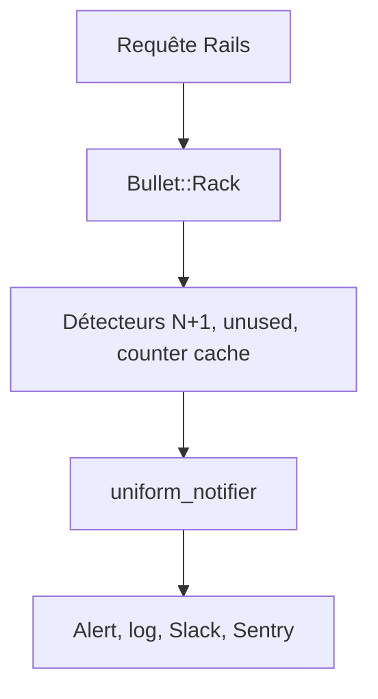

# flyerhzm/bullet

> Gem Ruby on Rails qui détecte en développement les requêtes N+1 et les eager loadings inutiles.

## Le problème
Les requêtes N+1 d'ActiveRecord ralentissent une appli sans être visibles à l'œil nu.

## Ce que ça fait vraiment
Surveille les requêtes pendant le développement et signale : N+1, eager loading inutile, besoin de counter cache. Notifie par alerte navigateur, log `log/bullet.log`, console, pied de page, Sentry, Slack, OpenTelemetry et d'autres. Peut faire échouer des tests (`Bullet.raise`). Fonctionne avec ActiveRecord et Mongoid >= 4.0.

## Comment c'est branché
Schéma simplifié d'après la fiche, sans diagramme fourni.



## Essayer
```bash
gem install bullet
bundle exec rails g bullet:install
```
```ruby
gem 'bullet', group: 'development'
```

## Coût et pièges
Gratuit. Le besoin réel est Ruby et Rails, absents de la liste des prérequis : sans eux, rien à faire. À garder hors production.

## Ce que ce n'est pas
Pas un profileur général ni un outil de monitoring en production. Il ne corrige rien : il indique où ajouter `includes`.

## Alternatives
Aucune alternative nommée dans le README.

## Pour toi
À ignorer pour un profil data / IA / MLOps tant que tu ne maintiens pas d'appli Rails : l'outil est bon mais hors de ta pile.

